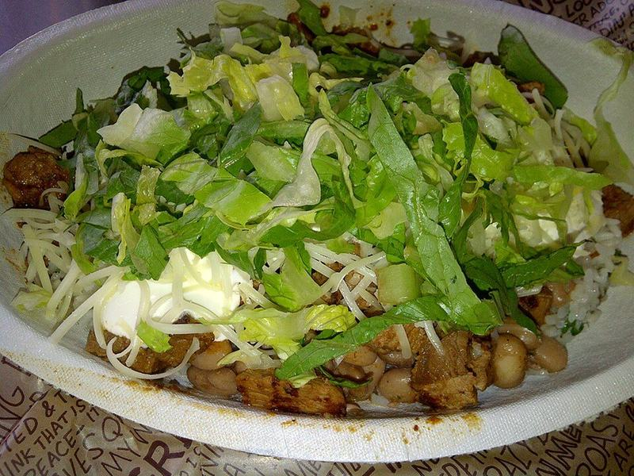

# Chipotle-Style Chicken Burrito Bowls

Photo: 乾隆帝 · CC BY-SA 3.0 · [source](https://commons.wikimedia.org/wiki/File:Burrito_Bowl.jpg)

**Lunch** · Tex-Mex · 30 min · serves 4 · skill 1/3

> Smoky chipotle-marinated chicken over cilantro-lime rice with black beans, corn salsa, cheese and guacamole. Meal-preps perfectly.

| Per serving | kcal | Protein | Carbs | Fat | Fiber | Sodium | Cost |
| --- | --- | --- | --- | --- | --- | --- | --- |
| | 870 | 54 g | 86 g | 36 g | 15 g | 1070 mg | $3.37 |

Contains: dairy, spicy

## Ingredients

- 1½ lb boneless thighs
- 2 chipotles in adobo plus 1 tbsp sauce
- 3 limes
- 3 garlic cloves
- 1½ cups rice
- 1 bunch cilantro
- 1 can black beans
- 1 cup corn
- 1 cup shredded cheese
- 2 avocados
- 1 romaine heart

From the pantry: 2 tbsp oil, 1 tsp cumin, 1 tsp oregano, salt

## Steps

1. Blend or mash the chipotles, garlic, juice of 1 lime, oil, cumin, oregano and 1 tsp salt. Coat the chicken and marinate 15 minutes.
2. Grill or sear the chicken in a hot skillet, 5 to 6 minutes per side, until charred. Rest and chop.
3. Cook the rice and stir in chopped cilantro and the juice of 1 lime.
4. Char the corn in a dry pan and mix with diced onion, cilantro and lime. Mash the avocados with lime and salt.
5. Build bowls: rice, lettuce, beans, chicken, corn salsa, cheese and guacamole.

**Tip:** Pack the guac with plastic pressed onto its surface and it stays green for 2 days.

## Storing

Fridge 4 days · freezer up to 3 months. Pack rice, chicken and beans together and the cold toppings separately. Microwave covered, 1½ to 2 minutes, stirring halfway.

## Other ways to make it

- Steak
- Shrimp
- Pork
- Tofu
