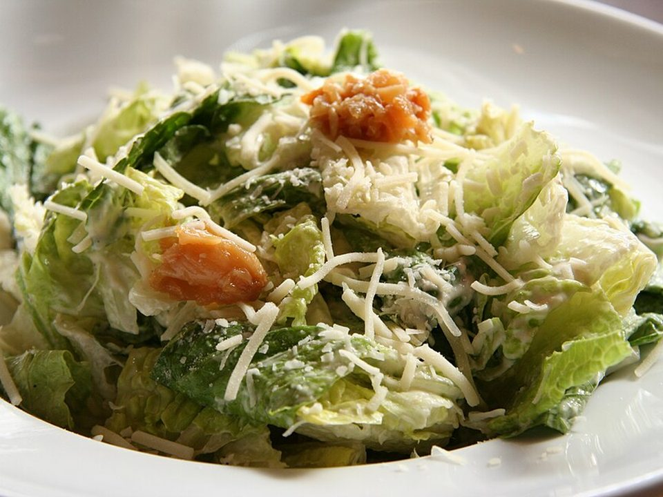

# Crispy Chicken Caesar Wraps

Photo: Geoff Peters from Vancouver, BC, Canada · CC BY 2.0 · [source](https://commons.wikimedia.org/wiki/File:Caesar_salad_(2).jpg)

**Lunch** · American comfort · 15 min · serves 4 · skill 1/3

> Crunchy romaine, rotisserie chicken, shaved Parmesan and garlicky Caesar dressing rolled tight in a toasted tortilla.

| Per serving | kcal | Protein | Carbs | Fat | Fiber | Sodium | Cost |
| --- | --- | --- | --- | --- | --- | --- | --- |
| | 560 | 26 g | 30 g | 37 g | 3 g | 1580 mg | $2.08 |

Contains: dairy, gluten, egg, fish

## Ingredients

- 3 cups chopped rotisserie chicken
- 2 romaine hearts, chopped
- ½ cup shaved Parmesan
- ½ cup Caesar dressing
- 4 large flour tortillas
- ½ lemon

From the pantry: Croutons (optional), black pepper

## Steps

1. Toss the romaine, chicken and Parmesan with the dressing, a squeeze of lemon and lots of pepper.
2. Warm the tortillas so they're pliable.
3. Pile the salad down the center of each and add crushed croutons for crunch.
4. Fold in the sides and roll tightly.
5. Toast seam-side down in a dry skillet for 1 minute per side and halve.

**Tip:** Pack the dressing separately if you're making these for the next day.

## Storing

Fridge 1 days · freezer not recommended. Pack the dressing separately and wrap the day you eat it.

## Other ways to make it

- Shrimp
- Ground beef
- Black beans (veg)
