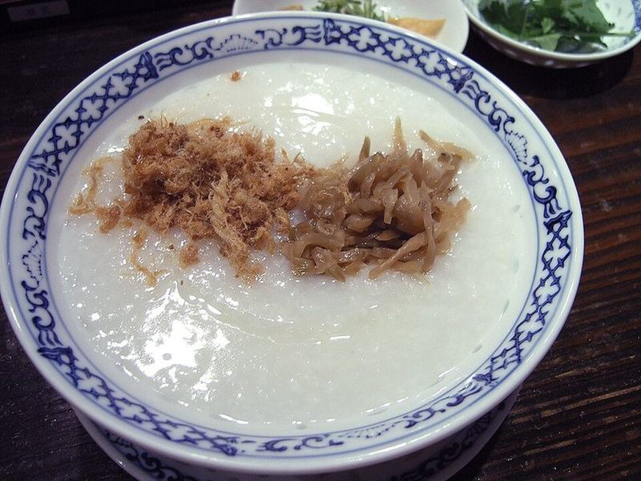

# Ginger Chicken Congee with Jammy Eggs

Photo: Daiju Azuma · CC BY-SA 2.5 · [source](https://commons.wikimedia.org/wiki/File:Chinese_rice_congee.jpg)

**Breakfast** · Chinese · 75 min · serves 4 · skill 1/3

> Silky, slow-simmered rice porridge infused with ginger and garlic, full of tender shredded chicken and finished with soy, sesame oil, green onions and a jammy egg.

| Per serving | kcal | Protein | Carbs | Fat | Fiber | Sodium | Cost |
| --- | --- | --- | --- | --- | --- | --- | --- |
| | 460 | 34 g | 41 g | 17 g | 1 g | 1550 mg | $1.96 |

Contains: gluten, egg, sesame

## Ingredients

- 1 cup jasmine rice, rinsed
- 1 lb boneless chicken thighs
- 4 cups chicken broth
- 2-inch piece ginger, half sliced and half in thin matchsticks
- 3 garlic cloves, smashed
- 4 eggs
- 4 green onions, sliced
- 2 tbsp soy sauce

From the pantry: 1 tbsp oil, 1 tbsp sesame oil, ½ tsp white pepper, salt

## Steps

1. Toss the rinsed rice with the oil and a pinch of salt. In a large pot, bring the rice, broth, 4 cups water, sliced ginger, garlic and chicken to a boil over high.
2. Reduce to a gentle simmer, partly cover, and cook 20 minutes. Lift out the chicken, which should read 175°F inside, and shred it with two forks.
3. Keep simmering the rice, stirring the bottom every 10 minutes, until it breaks down into a thick, creamy porridge, 35 to 45 minutes more. Add a splash of water if it gets stiffer than you like.
4. Meanwhile, lower the eggs into boiling water for 6½ minutes, then into ice water. Peel and halve.
5. Fish out the ginger slices and garlic, stir the chicken back in, and season with white pepper and salt. Serve topped with the eggs, ginger matchsticks, green onions, soy sauce and sesame oil.

**Tip:** Tossing the raw rice in a little oil and salt before simmering is a Cantonese trick that helps the grains break down into a smoother, silkier congee.

## Storing

Fridge 4 days · freezer up to 2 months. Congee thickens as it sits. Reheat on the stove with ¼ to ½ cup water per serving, stirring, until loose and steaming.

## Other ways to make it

- Steak
- Shrimp
- Pork
- Tofu
