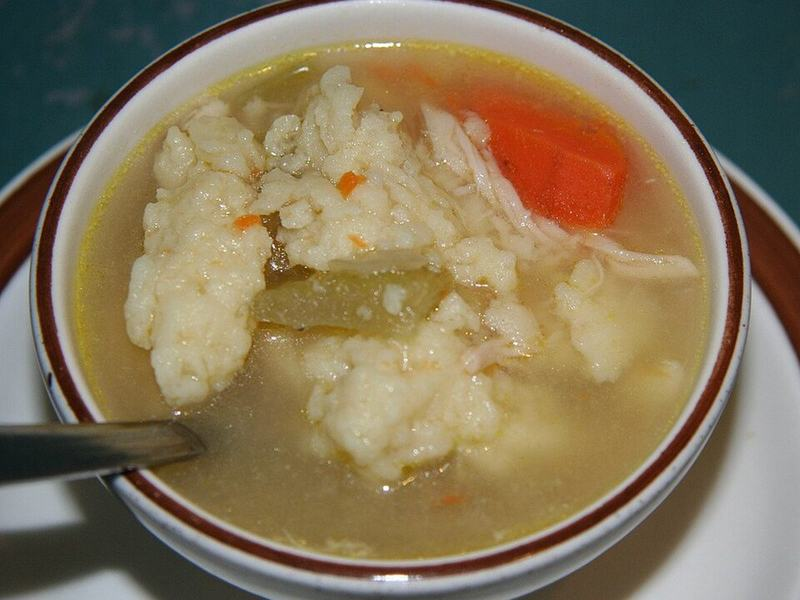

# Chicken & Dumplings

Photo: Jonathunder · CC BY-SA 3.0 · [source](https://commons.wikimedia.org/wiki/File:ChickenDumplings.jpg)

**Dinner** · Southern & Cajun · 45 min · serves 6 · skill 1/3

> Creamy chicken stew with carrots and celery, topped with tender, fluffy biscuit dumplings. Pure Southern comfort.

| Per serving | kcal | Protein | Carbs | Fat | Fiber | Sodium | Cost |
| --- | --- | --- | --- | --- | --- | --- | --- |
| | 505 | 25 g | 51 g | 23 g | 4 g | 2040 mg | $1.78 |

Contains: dairy, gluten

## Ingredients

- 3 cups shredded chicken
- 1 onion
- 2 carrots
- 2 celery stalks
- 6 cups broth
- ¾ cup milk
- 1 can refrigerated biscuits, quartered
- 1 cup peas
- 4 tbsp butter

From the pantry: ⅓ cup flour, 1 tsp thyme, salt, pepper

## Steps

1. Melt the butter in a Dutch oven and cook the onion, carrots and celery until soft, 8 minutes.
2. Stir in the flour and thyme for 1 minute, then whisk in the broth and milk. Simmer until slightly thickened.
3. Add the chicken and peas and season well.
4. Drop the biscuit pieces on top, cover and simmer gently 15 minutes without lifting the lid.
5. Check that the dumplings are cooked through (no raw dough inside) and serve.

**Tip:** Keep the lid on so the dumplings steam and puff.

## Storing

Fridge 3 days · freezer not recommended. Dumplings get soggy when frozen. Reheat gently with a splash of broth.

## Other ways to make it

- Shrimp
- Ground beef
- Black beans (veg)
