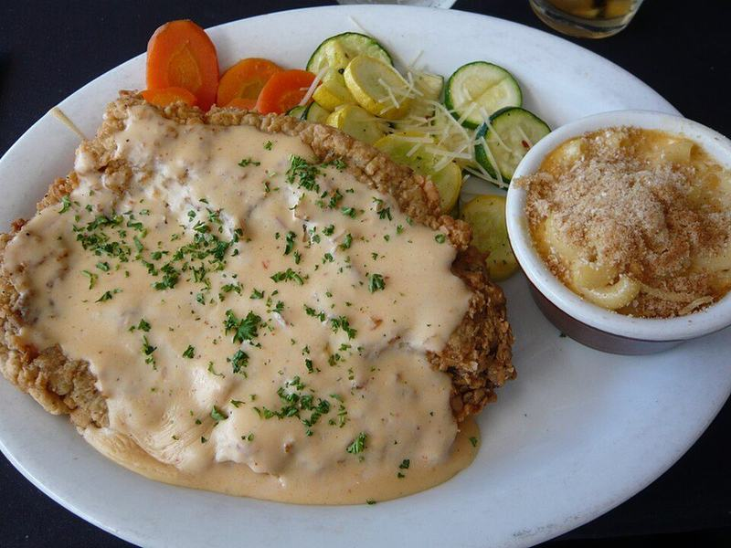

# Chicken-Fried Steak with Country Gravy & Mashed Potatoes

Photo: Jessica from Hove, United Kingdom · CC BY 2.0 · [source](https://commons.wikimedia.org/wiki/File:Flickr_wordridden_3397801155--Chicken_fried_steak.jpg)

**Dinner** · Southern & Cajun · 55 min · serves 4 · skill 2/3

> Craggy, crunchy buttermilk-battered cube steaks smothered in peppery cream gravy, with mashed potatoes and green beans. Pure Texas diner comfort.

| Per serving | kcal | Protein | Carbs | Fat | Fiber | Sodium | Cost |
| --- | --- | --- | --- | --- | --- | --- | --- |
| | 835 | 54 g | 59 g | 44 g | 7 g | 650 mg | $3.26 |

Contains: gluten, dairy, egg, beef

## Ingredients

- 4 beef cube steaks (about 1½ lb)
- 1 cup buttermilk
- 2 eggs
- 2½ cups milk, divided
- 4 tbsp butter, divided
- 2 lb russet potatoes, peeled and cut in chunks
- 12 oz green beans, trimmed

From the pantry: 1¼ cups flour, for dredging, ½ cup oil, for shallow-frying, 1 tsp garlic powder, 1 tsp paprika, ¼ tsp cayenne, 2 tsp salt, 2 tsp black pepper

## Steps

1. Boil the potatoes in salted water until tender, 15 to 18 minutes. Drain and mash with half the butter, ½ cup of the milk and salt. Steam or boil the green beans until crisp-tender, 5 minutes.
2. Mix 1 cup of the flour with the garlic powder, paprika, cayenne, 1 tsp salt and 1 tsp pepper. Whisk the buttermilk and eggs in another dish. Dredge each steak in flour, dip in the buttermilk, then press firmly into the flour again.
3. Heat the oil in a large skillet over medium-high to 350°F. Fry the steaks two at a time until deep golden and crisp, 3 to 4 minutes per side. Drain on a rack set over a sheet pan in a 200°F oven.
4. Pour off all but 2 tbsp of the oil. Add the remaining butter and ¼ cup flour and whisk over medium for 1 minute. Slowly whisk in the remaining 2 cups milk and simmer until thick, 3 to 4 minutes. Season with the remaining salt and lots of pepper.
5. Serve the steaks smothered in gravy with the mashed potatoes and green beans.

**Tip:** Let the coated steaks sit on a rack for 10 minutes before frying. The coating hydrates and grips the meat, so it won't slide off in the pan.

## Storing

Fridge 3 days · freezer not recommended. Store gravy separately. Re-crisp steaks at 400°F for 8 to 10 minutes and warm the gravy on the stove with a splash of milk.

