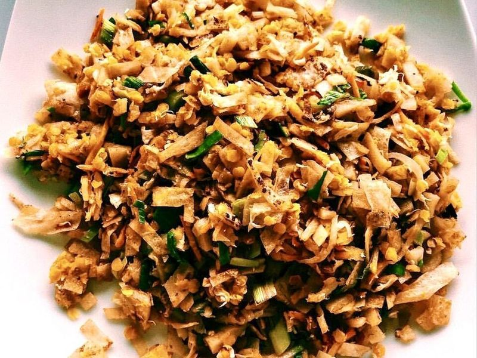

# Chicken Kottu Roti

Photo: Dan arndt · CC BY-SA 4.0 · [source](https://commons.wikimedia.org/wiki/File:Chicken_Kottu.jpg)

**Lunch** · Sri Lankan · 45 min · serves 4 · skill 2/3

> Sri Lanka's beloved street-food stir-fry: chopped flaky roti tossed on a hot griddle with curried chicken, scrambled egg, cabbage and carrots until every strip is coated in spicy gravy.

| Per serving | kcal | Protein | Carbs | Fat | Fiber | Sodium | Cost |
| --- | --- | --- | --- | --- | --- | --- | --- |
| | 785 | 36 g | 60 g | 44 g | 7 g | 980 mg | $2.88 |

Contains: gluten, egg, spicy

## Ingredients

- 6 frozen parathas
- 1 lb boneless chicken thighs, in small pieces
- 3 eggs, beaten
- ¼ head cabbage, thinly sliced (about 3 cups)
- 2 carrots, cut into matchsticks
- 4 green onions, sliced
- 1 small onion, sliced
- 1 tbsp grated ginger
- 4 garlic cloves, minced
- 1 green chili, chopped
- 2 tbsp curry powder
- ⅓ cup coconut milk
- 1 lime, in wedges

From the pantry: 3 tbsp oil, 1 tsp salt, ½ tsp chili powder, ½ tsp black pepper, 1 tsp mustard seeds

## Steps

1. Cook the parathas in a dry skillet as the package directs until golden. Let them cool slightly, then stack and cut into ½-inch strips.
2. Make a quick curry: heat 1 tbsp oil in a large skillet or wok over medium-high, add the mustard seeds, then half the ginger and garlic, the chicken, curry powder, chili powder and ½ tsp salt. Cook until the chicken is browned, 5 minutes. Add the coconut milk and ¼ cup water and simmer until the chicken is cooked through and the gravy is thick, 5 to 6 minutes. Scrape into a bowl.
3. Wipe the pan, add the rest of the oil and fry the onion, green chili and remaining ginger and garlic over high heat for 2 minutes. Add the cabbage and carrots and stir-fry until just wilted but still crunchy, 3 to 4 minutes.
4. Push the vegetables aside, pour the eggs into the cleared space and scramble until just set, then mix them through.
5. Add the chicken with its gravy and the roti strips. Toss and chop at everything with the edge of a metal spatula over high heat until the roti is hot and coated, 3 to 4 minutes. Season with pepper and salt, fold in the green onions and serve with lime.

**Tip:** Street vendors chop the kottu with two flat metal blades, and the clatter is half the fun. Two sturdy metal spatulas work the same way. Leftover chicken curry of any kind makes a great shortcut.

Adapted from [dish Magazine](https://www.dish.co.nz/recipes/chicken-kottu-roti).

## Storing

Fridge 2 days · freezer not recommended. Best eaten right away. Reheat in a hot skillet with a splash of water so the roti softens again.

