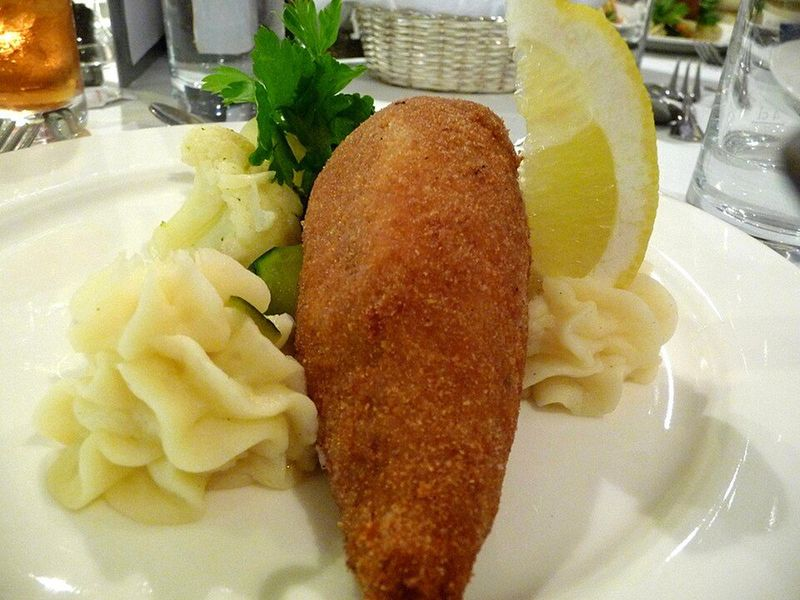

# Chicken Kyiv with Garlic-Dill Butter & Mashed Potatoes

Photo: Bev Sykes from Davis, CA, USA · CC BY 2.0 · [source](https://commons.wikimedia.org/wiki/File:Chicken_Kiev_Flickr.jpg)

**Dinner** · Russian & Ukrainian · 90 min · serves 4 · skill 3/3

> Crisp, golden breaded chicken breasts that burst with molten garlic, lemon and dill butter when you cut in, with creamy mashed potatoes to catch every drop.

| Per serving | kcal | Protein | Carbs | Fat | Fiber | Sodium | Cost |
| --- | --- | --- | --- | --- | --- | --- | --- |
| | 870 | 64 g | 62 g | 41 g | 6 g | 690 mg | $3.30 |

Contains: gluten, dairy, egg

## Ingredients

- 4 boneless chicken breasts (2 lb)
- 7 tbsp butter, softened
- ¼ cup chopped dill
- 2 tbsp chopped parsley
- 3 garlic cloves, finely grated
- 1 lemon, zested, plus wedges
- 2 eggs
- 1 cup panko breadcrumbs
- 1½ lb russet potatoes
- ½ cup milk

From the pantry: ⅓ cup flour, 3 tbsp oil, 1 tsp salt, ½ tsp pepper

## Steps

1. Mash 6 tbsp butter with the dill, parsley, garlic, lemon zest and a pinch of salt. Shape into 4 small logs on plastic wrap and freeze until firm, about 20 minutes.
2. Cut a deep pocket into the thick side of each breast without cutting through. Tuck in a butter log and press the opening closed, folding the thin end over. Season, then coat in flour, beaten egg and panko, pressing well; dip in egg and panko a second time for a sealed crust. Chill 20 minutes.
3. Heat the oven to 400°F. Boil the potatoes in salted water until tender, 15 to 18 minutes, drain and mash with the last 1 tbsp butter, the warm milk and salt.
4. Heat the oil in an ovenproof skillet over medium-high and fry the chicken until golden, 2 to 3 minutes per side.
5. Transfer the skillet to the oven and bake until the chicken reaches 165°F inside, 18 to 22 minutes. Rest 5 minutes, then serve with the mash and lemon wedges.

**Tip:** Seal the pocket completely and double-coat the crumbs, otherwise the butter leaks out in the pan. Rest before cutting so the butter stays molten instead of flooding out all at once.

Adapted from [Milk Street](https://www.177milkstreet.com/recipes/chicken-kyiv).

## Storing

Fridge 3 days · freezer up to 2 months. Freeze breaded, uncooked Kyivs and bake from frozen for 35 to 40 minutes. Reheat cooked ones at 375°F for 15 minutes.

