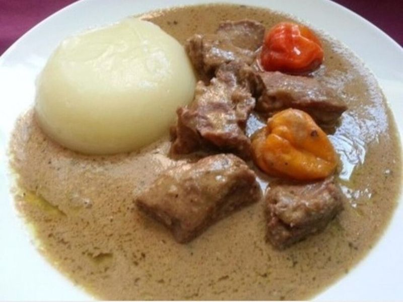

# Senegalese Chicken Maafe (Peanut Stew)

Photo: Marshiayers · CC0 · [source](https://commons.wikimedia.org/wiki/File:Mafe.malien.jpg)

**Dinner** · Nigerian & West African · 70 min · serves 6 · skill 1/3

> A velvety tomato-peanut stew with chunks of chicken, sweet potato, carrot and cabbage, rich and gently warm, ladled over rice. Comfort food across West Africa.

| Per serving | kcal | Protein | Carbs | Fat | Fiber | Sodium | Cost |
| --- | --- | --- | --- | --- | --- | --- | --- |
| | 675 | 43 g | 77 g | 22 g | 6 g | 990 mg | $2.35 |

Contains: nuts

## Ingredients

- 2 lb boneless chicken thighs, in bite-size chunks
- ½ cup natural creamy peanut butter
- 1 onion, chopped
- 3 garlic cloves, minced
- 1 tbsp grated ginger
- 2 Roma tomatoes, diced
- 4 cups chicken broth
- 1 medium sweet potato, in 1-inch chunks
- 2 carrots, sliced
- ¼ small cabbage, in wedges
- 2 cups rice
- ½ bunch cilantro, chopped

From the pantry: 2 tbsp oil, 3 tbsp tomato paste, 1 tsp smoked paprika, ½ tsp red pepper flakes, 1 tsp salt, ½ tsp pepper

## Steps

1. Heat the oil in a Dutch oven over medium-high. Brown the chicken in two batches, 4 to 5 minutes each, and set aside.
2. Lower the heat to medium, add the onion and cook 5 minutes until soft. Stir in the garlic, ginger, paprika, pepper flakes and tomato paste for 1 minute, then add the tomatoes and broth and return the chicken. Cover and simmer 15 minutes.
3. Add the sweet potato, carrots and cabbage and simmer uncovered until the vegetables are tender and the sauce has reduced a little, 25 to 30 minutes. Start the rice.
4. Whisk the peanut butter in a bowl with two ladles of the hot sauce until smooth, then stir it into the pot. Simmer 5 minutes more, stirring so it doesn't catch, until thick and glossy.
5. Season with salt and pepper, scatter with cilantro and serve over rice.

**Tip:** Use natural peanut butter with no added sugar; sweetened brands make the stew taste like dessert. Add a halved habanero with the vegetables if you like heat, and fish it out before serving.

Adapted from [The Healthy Foodie](https://thehealthyfoodie.com/senegalese-mafe/).

## Storing

Fridge 5 days · freezer up to 3 months. The stew thickens overnight; loosen with a splash of broth. Reheat on the stove over medium-low, stirring, 6 to 8 minutes.

