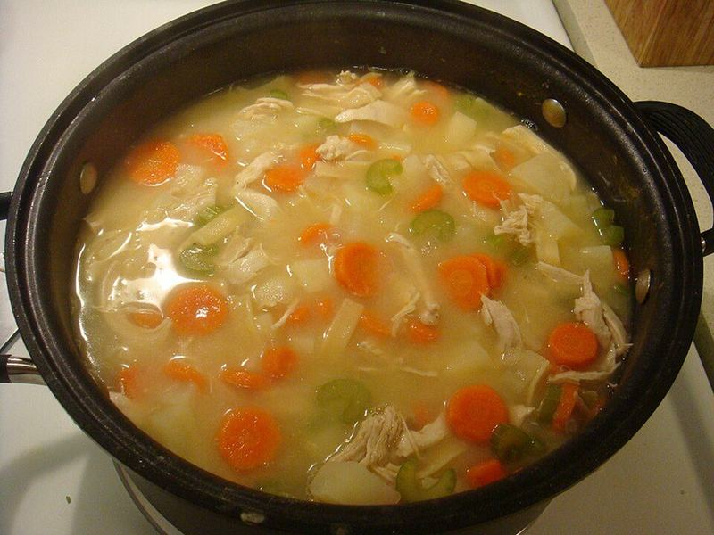

# Homemade Chicken Noodle Soup with Wide Egg Noodles

Photo: Debs (ò‿ó)♪ from Bellevue, WA, USA · CC BY 2.0 · [source](https://commons.wikimedia.org/wiki/File:Chicken_noodle_soup.jpg)

**Lunch** · American comfort · 50 min · serves 6 · skill 1/3

> Tender pulled chicken thighs, sweet carrots and celery and thick egg noodles in a golden, herby broth that tastes like it simmered all day.

| Per serving | kcal | Protein | Carbs | Fat | Fiber | Sodium | Cost |
| --- | --- | --- | --- | --- | --- | --- | --- |
| | 435 | 38 g | 38 g | 14 g | 4 g | 1430 mg | $2.39 |

Contains: gluten, egg, dairy

## Ingredients

- 2 lb boneless chicken thighs
- 8 cups (2 cartons) chicken broth
- 8 oz wide egg noodles
- 4 carrots, sliced into coins
- 3 celery stalks, sliced
- 1 onion, diced
- 3 garlic cloves, minced
- ½ bunch parsley, chopped
- 1 lemon

From the pantry: 2 tbsp butter, 1 tbsp oil, 1 tsp dried thyme, 2 bay leaves, salt, pepper

## Steps

1. Melt the butter with the oil in a large pot over medium heat. Add the onion, carrots and celery with a pinch of salt and cook, stirring, until the onion is soft, 6 to 8 minutes. Stir in the garlic and thyme for 30 seconds.
2. Add the broth, 2 cups water, the bay leaves and the whole chicken thighs. Bring to a boil, then lower to a gentle simmer and cook uncovered until the chicken is 175°F inside and tender, 20 to 25 minutes.
3. Lift the chicken onto a board and shred it with two forks. Fish out the bay leaves.
4. Bring the soup back to a boil, add the noodles and cook until just tender, 6 to 8 minutes.
5. Return the chicken, stir in the parsley and a squeeze of lemon, and season well with salt and pepper before serving.

**Tip:** If you plan to have leftovers, cook the noodles separately and add them to each bowl, so they don't soak up all the broth overnight.

## Storing

Fridge 4 days · freezer up to 3 months. Freeze without noodles if you can. Reheat on the stove until steaming, adding a splash of water or broth.

## Other ways to make it

- Steak
- Shrimp
- Pork
- Tofu
