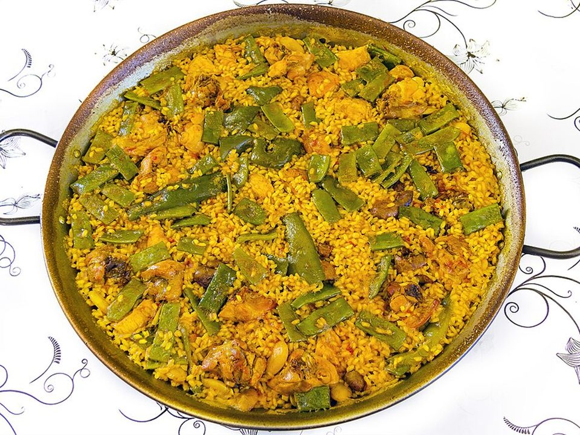

# Chicken, Chorizo & Shrimp Paella

Photo: Jan Harenburg · CC BY-SA 4.0 · [source](https://commons.wikimedia.org/wiki/File:01_Paella_Valenciana_original.jpg)

**Dinner** · Spanish · 55 min · serves 6 · skill 3/3

> A showstopper skillet of smoky paprika rice with chicken, chorizo and shrimp, and the crispy socarrat bottom everyone fights over.

| Per serving | kcal | Protein | Carbs | Fat | Fiber | Sodium | Cost |
| --- | --- | --- | --- | --- | --- | --- | --- |
| | 640 | 40 g | 58 g | 28 g | 5 g | 1480 mg | $2.74 |

Contains: shellfish, pork

## Ingredients

- 1 lb boneless thighs, in chunks
- 9 oz chorizo, sliced or crumbled
- 8 oz shrimp
- 1 onion
- 1 red pepper
- 4 garlic cloves
- 1 cup crushed tomatoes
- 2 cups short-grain or long-grain rice
- 4 cups broth
- 1 cup peas
- 2 lemons
- 2 tsp smoked paprika

From the pantry: 3 tbsp olive oil, pinch of saffron (optional), salt

## Steps

1. Brown the chicken and chorizo in the oil in a 12-inch skillet. Push aside and cook the onion, pepper and garlic until soft.
2. Add the paprika, saffron and tomatoes and cook 2 minutes. Stir in the rice to coat.
3. Pour in the hot broth and 1 tsp salt, stir once and spread evenly. Don't stir again.
4. Simmer 18 minutes. Tuck in the shrimp and scatter the peas, then cook 5 minutes more until the shrimp are pink.
5. Turn the heat up for 1 to 2 minutes until you hear crackling (the socarrat). Rest 5 minutes and serve with lemon.

**Tip:** Resist stirring after the broth goes in. Stirring makes it risotto, not paella.

## Storing

Fridge 2 days · freezer not recommended. Shrimp toughens when frozen. Microwave covered with a splash of broth.

## Other ways to make it

- Steak
- Shrimp
- Pork
- Tofu
