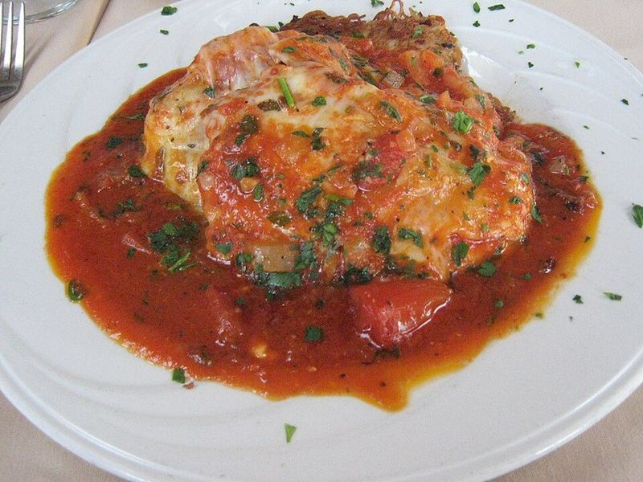

# Crispy Chicken Parmesan

Photo: blynneda · CC BY 2.0 · [source](https://commons.wikimedia.org/wiki/File:Venezia_Chicken_Pizzaiola.jpg)

**Dinner** · Italian · 45 min · serves 4 · skill 2/3

> Thin, golden panko-Parmesan cutlets topped with marinara and bubbling mozzarella, served over spaghetti. The red-sauce classic, done right.

| Per serving | kcal | Protein | Carbs | Fat | Fiber | Sodium | Cost |
| --- | --- | --- | --- | --- | --- | --- | --- |
| | 1240 | 80 g | 121 g | 47 g | 8 g | 1870 mg | $3.67 |

Contains: dairy, gluten, egg

## Ingredients

- 1½ lb chicken breasts, halved horizontally into cutlets
- 2 eggs
- 1½ cups panko
- ¾ cup grated Parmesan, divided
- 24 oz marinara
- 2 cups shredded mozzarella
- 1 lb spaghetti
- fresh basil

From the pantry: ½ cup flour, ½ cup oil for frying, 1 tsp garlic powder, salt, pepper

## Steps

1. Pound the cutlets to an even ¼ inch and season with salt and pepper. Set up 3 shallow dishes: flour; beaten eggs; panko mixed with ½ cup Parmesan and the garlic powder.
2. Dredge each cutlet in flour, then egg, then press firmly into the panko.
3. Fry in ¼ inch of hot oil over medium-high until deep golden, 3 minutes per side. Drain on a rack. Heat the broiler. Boil the spaghetti.
4. Lay the cutlets on a sheet pan, top each with a few spoons of marinara and a handful of mozzarella and Parmesan. Broil 2 to 3 minutes until bubbling and spotty.
5. Toss the spaghetti with the remaining warm marinara. Serve the chicken on top with torn basil.

**Tip:** Put the sauce only on the center of each cutlet so the edges stay crunchy.

## Storing

Fridge 3 days · freezer up to 2 months. Reheat cutlets at 400°F for 10 minutes so they stay crisp. Microwave the pasta separately.

## Other ways to make it

- Steak
- Shrimp
- Pork
- Tofu
