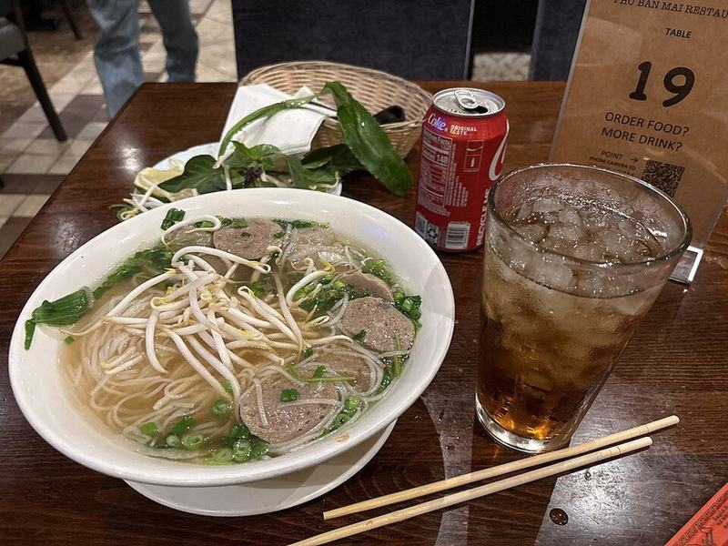

# 30-Minute Chicken Pho

Photo: SerraKnightz · CC BY 4.0 · [source](https://commons.wikimedia.org/wiki/File:Bowl_of_Meatball_pho.jpg)

**Dinner** · Vietnamese · 40 min · serves 4 · skill 2/3

> A shortcut pho with real depth: broth simmered with charred onion, ginger and warm spices, poured over rice noodles and chicken with all the fresh herbs.

| Per serving | kcal | Protein | Carbs | Fat | Fiber | Sodium | Cost |
| --- | --- | --- | --- | --- | --- | --- | --- |
| | 455 | 36 g | 69 g | 4 g | 5 g | 2200 mg | $3.47 |

Contains: fish

## Ingredients

- 1 lb chicken breast
- 8 cups chicken broth
- 1 onion, halved
- 3-inch ginger, halved
- 3 tbsp fish sauce
- 8 oz flat rice noodles
- bean sprouts
- basil (Thai basil if you can)
- cilantro
- limes
- jalapeño, sliced

From the pantry: 3 star anise, 1 cinnamon stick, 4 cloves, 1 tsp coriander seed, 1 tbsp sugar, hoisin and sriracha to serve

## Steps

1. Char the onion and ginger cut-side down in a dry pot over high heat until blackened in spots, 5 minutes.
2. Toast the spices for 1 minute, then add the broth, fish sauce and sugar. Add the chicken and simmer gently 15 minutes until cooked. Remove and shred the chicken.
3. Simmer the broth 10 minutes more, then strain and season with fish sauce.
4. Cook the noodles per the package and divide among big bowls with the chicken.
5. Ladle over the boiling-hot broth. Serve with sprouts, herbs, lime, chilies, hoisin and sriracha.

**Tip:** The broth must be at a hard boil when you pour it so it warms the noodles and chicken.

## Storing

Fridge 4 days · freezer up to 3 months. Store broth, noodles and chicken separately. Freeze just the broth.

## Other ways to make it

- Steak
- Shrimp
- Pork
- Tofu
