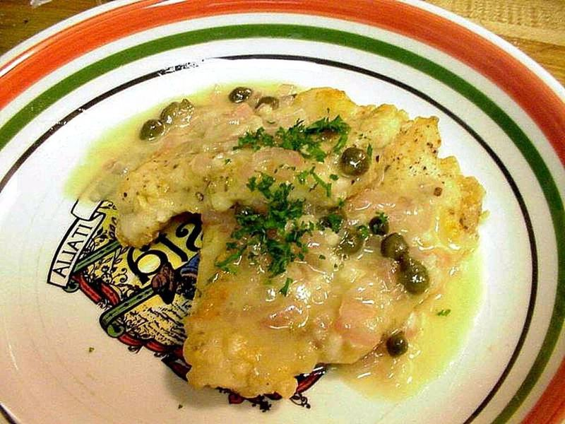

# Chicken Piccata with Lemon-Caper Butter & Spaghetti

Photo: Jon Sullivan · Public domain · [source](https://commons.wikimedia.org/wiki/File:Chicken_piccata_dinner_cooking_food.jpg)

**Dinner** · Italian · 35 min · serves 4 · skill 2/3

> Golden, thin chicken cutlets in a bright, buttery lemon and caper pan sauce, spooned over spaghetti to catch every drop.

| Per serving | kcal | Protein | Carbs | Fat | Fiber | Sodium | Cost |
| --- | --- | --- | --- | --- | --- | --- | --- |
| | 745 | 52 g | 68 g | 30 g | 4 g | 870 mg | $2.37 |

Contains: gluten, dairy

## Ingredients

- 1½ lb chicken breasts, halved horizontally into thin cutlets
- 2 lemons, juiced, plus slices to serve
- 3 tbsp capers, drained
- ¾ cup chicken broth
- 4 tbsp butter, divided
- 2 garlic cloves, minced
- ¾ lb spaghetti or linguine
- ½ bunch parsley, chopped
- ¼ cup grated Parmesan, to serve

From the pantry: ½ cup flour, for dredging, 3 tbsp olive oil, 1 tsp salt, ½ tsp black pepper

## Steps

1. Put a big pot of salted water on to boil for the pasta. Season the cutlets with salt and pepper and dredge them in the flour, shaking off the excess.
2. Heat 2 tbsp oil and 1 tbsp butter in a large skillet over medium-high. Cook the cutlets in batches until golden and 165°F inside, 3 to 4 minutes per side. Move to a plate.
3. Cook the spaghetti until al dente. Meanwhile add the remaining oil and garlic to the skillet for 30 seconds, then pour in the broth and lemon juice, scraping up the browned bits. Simmer until reduced by about a third, 3 to 4 minutes.
4. Add the capers, then turn off the heat and swirl in the remaining butter until glossy. Return the chicken to the pan and turn to coat.
5. Toss the drained pasta with a few spoonfuls of the sauce and the Parmesan. Serve the chicken over the pasta with more sauce, parsley and lemon slices.

**Tip:** Swirl in the last of the butter off the heat. If the sauce boils after that, it can turn greasy instead of creamy.

## Storing

Fridge 3 days · freezer not recommended. Reheat in a covered skillet over low with a splash of broth until warm, 4 to 6 minutes.

## Other ways to make it

- Steak
- Shrimp
- Pork
- Tofu
