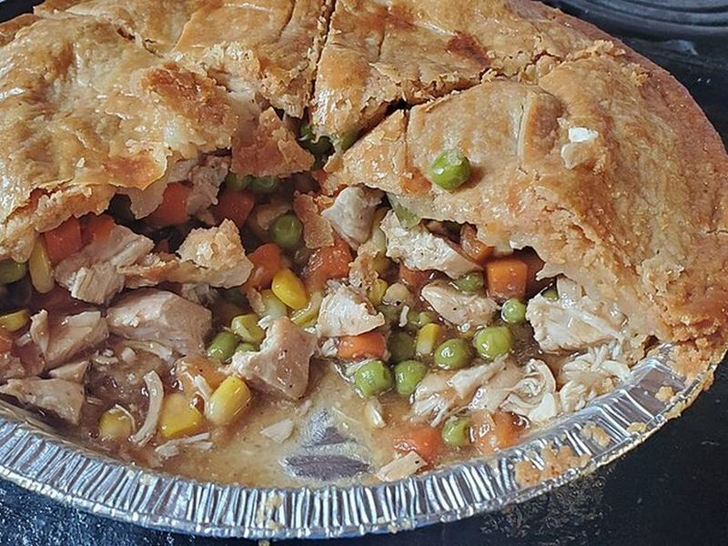

# Puff Pastry Chicken Pot Pie

Photo: MonicaVereanaWilliams · CC BY-SA 4.0 · [source](https://commons.wikimedia.org/wiki/File:Chicken_Pot_Pie,_cut_open.jpg)

**Dinner** · American comfort · 55 min · serves 6 · skill 2/3

> Creamy, thyme-scented chicken and vegetable filling under a flaky, golden puff pastry lid. Uses rotisserie chicken to keep it weeknight-friendly.

| Per serving | kcal | Protein | Carbs | Fat | Fiber | Sodium | Cost |
| --- | --- | --- | --- | --- | --- | --- | --- |
| | 530 | 22 g | 35 g | 34 g | 4 g | 880 mg | $1.67 |

Contains: dairy, gluten, egg

## Ingredients

- 3 cups shredded rotisserie chicken
- 4 tbsp butter
- 1 onion, diced
- 2 celery stalks, diced
- 2 carrots, diced
- 2 cups chicken broth
- ½ cup heavy cream or milk
- 1 cup frozen peas or mixed vegetables
- 1 sheet puff pastry, thawed
- 1 egg, beaten

From the pantry: ⅓ cup flour, 1 tsp dried thyme, salt, pepper

## Steps

1. Heat the oven to 400°F. Melt the butter in an oven-safe skillet and cook the onion, celery and carrots until soft, 8 minutes.
2. Stir in the flour and thyme for 1 minute, then the broth and cream. Simmer until thick, 3 minutes.
3. Stir in the chicken and frozen vegetables and season well.
4. Drape the puff pastry over the skillet, trim the overhang, brush with egg and cut 3 slits in the top.
5. Bake 25 minutes until puffed and deep golden. Rest 10 minutes before scooping.

**Tip:** Make sure the filling is well seasoned before you cover it. You can't taste it once the lid is on.

## Storing

Fridge 3 days · freezer up to 3 months. Reheat covered at 350°F for 20 minutes. Uncover for the last 5 to crisp the pastry.

## Other ways to make it

- Shrimp
- Ground beef
- Black beans (veg)
