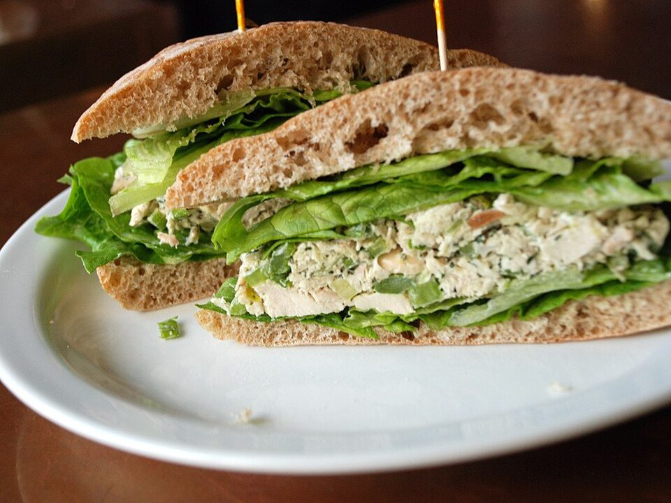

# Greek Yogurt Chicken Salad Wraps

Photo: Lara604 · CC BY-SA 2.0 · [source](https://commons.wikimedia.org/wiki/File:Chicken_salad_sandwich_01.jpg)

**Lunch** · American comfort · 15 min · serves 4 · skill 1/3

> Crunchy, tangy chicken salad with apple and celery bound in Greek yogurt instead of mayo, rolled up with greens for packable lunches.

| Per serving | kcal | Protein | Carbs | Fat | Fiber | Sodium | Cost |
| --- | --- | --- | --- | --- | --- | --- | --- |
| | 335 | 27 g | 38 g | 9 g | 4 g | 960 mg | $1.89 |

Contains: dairy, gluten

## Ingredients

- 3 cups shredded rotisserie chicken
- ¾ cup plain Greek yogurt
- 2 celery stalks, diced
- 1 crisp apple, diced
- 2 green onions, sliced
- ½ lemon
- 4 large flour tortillas
- 2 handfuls spring mix

From the pantry: 1 tbsp Dijon mustard, salt, pepper

## Steps

1. Stir together the yogurt, Dijon, lemon juice, ½ tsp salt and plenty of pepper.
2. Fold in the chicken, celery, apple and green onions.
3. Lay the greens across each tortilla and spoon the chicken salad down the center.
4. Fold in the sides and roll up tightly. Halve on a diagonal.
5. Wrap in parchment for lunches. They keep 2 days in the fridge.

**Tip:** Make a double batch of the salad on Sunday. Wrap it fresh each morning so the tortilla doesn't go soggy.

## Storing

Fridge 3 days · freezer not recommended. Keep the chicken salad separate and wrap the morning you eat it.

## Other ways to make it

- Shrimp
- Ground beef
- Black beans (veg)
