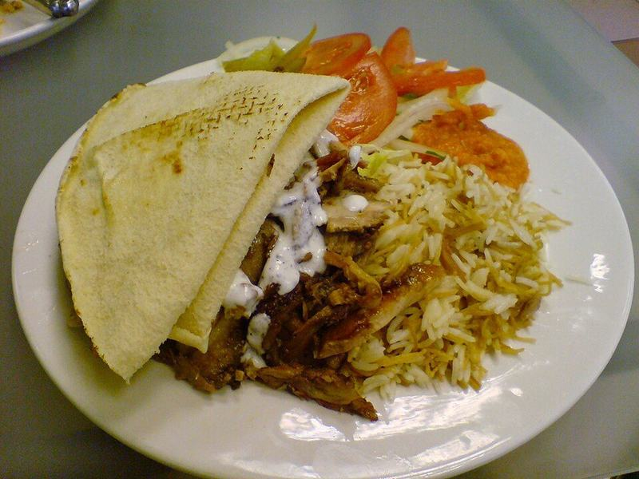

# Sheet-Pan Chicken Shawarma Plates

Photo: secretlondon123 from London, England · CC BY-SA 2.0 · [source](https://commons.wikimedia.org/wiki/File:Mixed_Shawarma_(2843435528).jpg)

**Dinner** · Lebanese & Levantine · 40 min · serves 4 · skill 1/3

> Warmly spiced, lemony chicken thighs and onions roasted until charred, with garlicky yogurt sauce, hummus, a crunchy salad and warm pita.

| Per serving | kcal | Protein | Carbs | Fat | Fiber | Sodium | Cost |
| --- | --- | --- | --- | --- | --- | --- | --- |
| | 665 | 51 g | 59 g | 26 g | 7 g | 960 mg | $3.54 |

Contains: dairy, gluten, sesame

## Ingredients

- 1½ lb boneless chicken thighs
- 2 lemons
- 4 garlic cloves
- 1 red or yellow onion, in wedges
- 1 cup plain Greek yogurt
- 1 cup hummus
- 1 cucumber, diced
- 4 Roma tomatoes, diced
- 1 bunch parsley
- 4 pita breads

From the pantry: ¼ cup olive oil; 2 tsp each cumin, paprika; 1 tsp each coriander, turmeric, cinnamon (pinch); salt

## Steps

1. Toss the chicken with 3 tbsp oil, the juice of 1 lemon, half the garlic, the spices and 1½ tsp salt. Marinate 15 minutes or overnight.
2. Spread the chicken and onion on a sheet pan and roast at 450°F for 20 to 25 minutes, then broil 2 minutes to char. Rest and slice.
3. Stir the yogurt with the remaining garlic, a squeeze of lemon and salt.
4. Toss the cucumber, tomatoes and chopped parsley with olive oil, lemon and salt.
5. Plate with a swoosh of hummus, the chicken and onions, salad, yogurt sauce and warm pita.

**Tip:** Marinate the chicken in the morning and dinner is 25 minutes of hands-off roasting.

## Storing

Fridge 4 days · freezer up to 3 months. Store chicken, salad and sauces separately. Microwave covered, 1½ to 2 minutes, stirring halfway.

## Other ways to make it

- Steak
- Shrimp
- Pork
- Tofu
