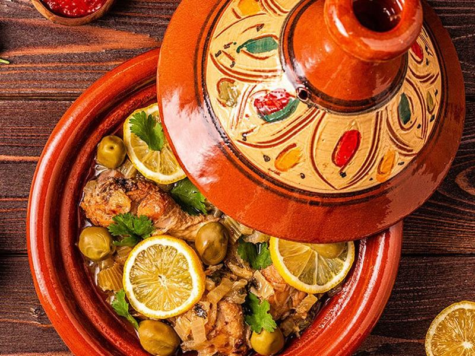

# Moroccan Chicken Tagine with Apricots

Photo: BBouchra00 · CC BY-SA 4.0 · [source](https://commons.wikimedia.org/wiki/File:Tajine-marocain-un-plat-varie-et-sain_(cropped).jpg)

**Dinner** · African · 55 min · serves 4 · skill 1/3

> Chicken braised with warm spices, chickpeas, sweet apricots and lemon until tender, spooned over fluffy couscous.

| Per serving | kcal | Protein | Carbs | Fat | Fiber | Sodium | Cost |
| --- | --- | --- | --- | --- | --- | --- | --- |
| | 855 | 62 g | 107 g | 20 g | 13 g | 1200 mg | $4.16 |

Contains: gluten

## Ingredients

- 2 lb boneless thighs
- 2 onions, sliced
- 4 garlic cloves
- 1-inch ginger
- 1 can chickpeas
- 4 oz dried apricots
- 1½ cups broth
- 1 lemon
- green olives (optional)
- 10 oz couscous
- cilantro

From the pantry: 2 tbsp olive oil, 2 tsp cumin, 1 tsp cinnamon, 1 tsp turmeric, 1 tsp paprika, 1 tbsp honey, salt

## Steps

1. Season the chicken with salt and half the spices and brown in the oil, 4 minutes per side. Remove.
2. Cook the onions until soft and golden, 8 minutes. Add the garlic, ginger and remaining spices for 1 minute.
3. Add the broth, chickpeas, apricots, honey and lemon zest. Return the chicken.
4. Cover and simmer 25 minutes until tender. Add olives and lemon juice.
5. Pour boiling water over the couscous, cover 5 minutes and fluff. Serve the tagine over couscous with cilantro.

**Tip:** Even better the next day as the spices deepen.

## Storing

Fridge 5 days · freezer up to 3 months. Reheat on the stove over medium until simmering, or microwave 2 to 3 minutes, stirring once.

## Other ways to make it

- Steak
- Shrimp
- Pork
- Tofu
