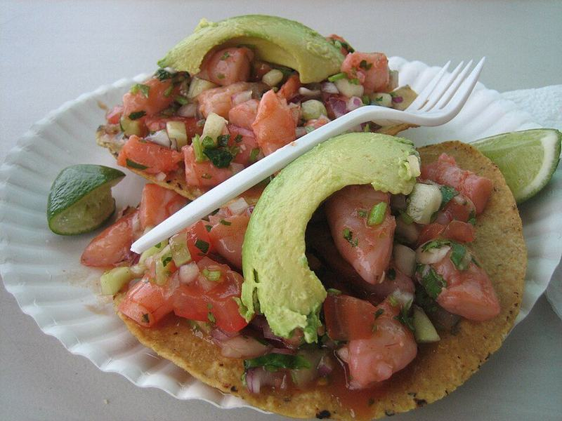

# Chicken Tinga Tostadas

Photo: Ernesto Andrade from San Francisco, California, USA · CC BY 2.0 · [source](https://commons.wikimedia.org/wiki/File:Flickr_dongkwan_540812245--Shrimp_Tostada.jpg)

**Dinner** · Mexican & Tex-Mex · 35 min · serves 4 · skill 1/3

> Shredded chicken simmered in a smoky chipotle-tomato sauce, piled onto crunchy oven-baked tostadas with refried beans, lettuce, crema and crumbled cheese.

| Per serving | kcal | Protein | Carbs | Fat | Fiber | Sodium | Cost |
| --- | --- | --- | --- | --- | --- | --- | --- |
| | 845 | 56 g | 71 g | 40 g | 20 g | 1610 mg | $3.48 |

Contains: dairy, spicy

## Ingredients

- 1½ lb chicken breasts
- 1 large onion, thinly sliced
- 3 garlic cloves
- 2 to 3 chipotles in adobo, chopped, plus 1 tbsp sauce
- 14 oz crushed tomatoes
- 12 corn tortillas
- 1 can refried beans, warmed
- 1 romaine heart, shredded
- ½ cup sour cream
- ½ cup crumbled cotija or feta
- 2 avocados

From the pantry: 3 tbsp oil, 1 tsp dried oregano, salt

## Steps

1. Simmer the chicken in salted water to cover until cooked through, 15 minutes. Shred with two forks and save 1 cup of the broth.
2. Brush the tortillas with oil, spread on sheet pans and bake at 400°F for 8 to 10 minutes, flipping once, until crisp and golden.
3. Cook the onion in 1 tbsp oil until soft and lightly browned. Add the garlic, chipotles and oregano for 1 minute.
4. Add the tomatoes and reserved broth, simmer 5 minutes, then stir in the chicken and simmer until saucy, 5 minutes. Season with salt.
5. Spread each tostada with beans, then chicken, lettuce, crema, cheese and avocado.

**Tip:** Start with 2 chipotles for medium heat. You can always stir in more adobo sauce.

## Storing

Fridge 4 days · freezer up to 3 months. Store chicken separately and crisp tostadas fresh. Microwave covered, 1½ to 2 minutes, stirring halfway.

## Other ways to make it

- Steak
- Shrimp
- Pork
- Tofu
