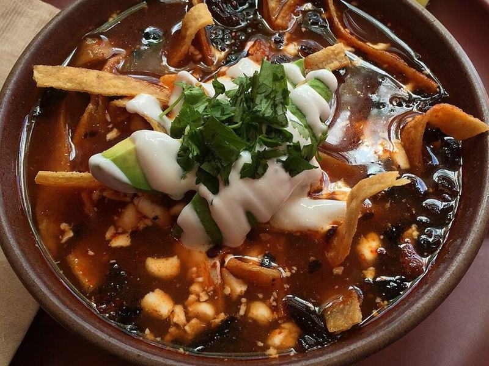

# Chicken Tortilla Soup

Photo: Wikiwrimo · CC BY-SA 4.0 · [source](https://commons.wikimedia.org/wiki/File:Tortilla_Soup.jpg)

**Dinner** · Mexican & Tex-Mex · 30 min · serves 6 · skill 1/3

> A smoky, tomato-rich broth loaded with chicken, black beans and corn, piled high with crunchy tortilla strips, avocado and lime.

| Per serving | kcal | Protein | Carbs | Fat | Fiber | Sodium | Cost |
| --- | --- | --- | --- | --- | --- | --- | --- |
| | 500 | 26 g | 50 g | 24 g | 12 g | 2170 mg | $2.19 |

Contains: dairy

## Ingredients

- 3 cups shredded rotisserie chicken
- 6 cups chicken broth
- 1½ cups chunky salsa
- 1 can diced tomatoes
- 1 can black beans, drained
- 1½ cups frozen corn
- 1 onion, diced
- 1 tbsp taco seasoning
- tortilla chips or strips
- 2 avocados
- shredded cheese
- 2 limes
- cilantro

From the pantry: 1 tbsp oil, salt

## Steps

1. Soften the onion in the oil in a large pot, 5 minutes. Stir in the seasoning for 30 seconds.
2. Add the broth, salsa and tomatoes. Bring to a simmer and cook 10 minutes.
3. Add the chicken, beans and corn and simmer 5 minutes more. Squeeze in 1 lime and season.
4. Ladle into bowls.
5. Top with crushed tortilla chips, avocado, cheese, cilantro and lime wedges.

**Tip:** This freezes well. Keep the toppings separate and add them fresh.

## Storing

Fridge 5 days · freezer up to 3 months. Store toppings separately. Reheat on the stove over medium until simmering, or microwave 2 to 3 minutes, stirring once.

## Other ways to make it

- Shrimp
- Ground beef
- Black beans (veg)
