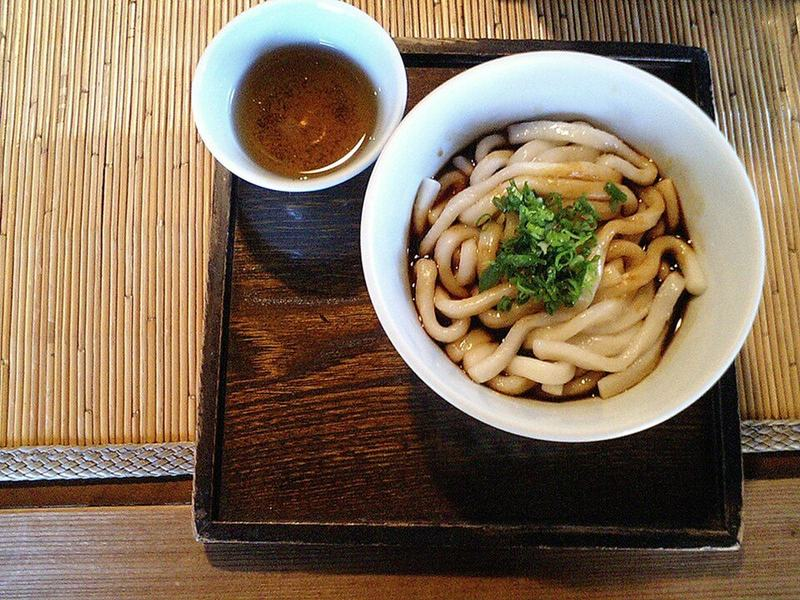

# Chicken Udon Noodle Soup with Bok Choy

Photo: MOTOI Kenkichi · CC BY-SA 3.0 · [source](https://commons.wikimedia.org/wiki/File:Fukusuke_IseUdon.JPG)

**Lunch** · Japanese · 35 min · serves 6 · skill 1/3

> Thick, chewy udon in a gingery soy-dashi-style broth with tender chicken, shiitakes and bok choy. It's the cozy noodle bowl you want on a cold day.

| Per serving | kcal | Protein | Carbs | Fat | Fiber | Sodium | Cost |
| --- | --- | --- | --- | --- | --- | --- | --- |
| | 510 | 38 g | 63 g | 11 g | 4 g | 2400 mg | $3.92 |

Contains: gluten

## Ingredients

- 1½ lb boneless chicken thighs, thinly sliced
- 6 blocks frozen udon
- 10 cups chicken broth
- ¼ cup soy sauce
- 2-inch piece ginger, sliced into coins
- 2 garlic cloves, smashed
- 5 oz shiitake mushrooms, sliced
- 1 lb baby bok choy, halved
- 1 bunch green onions, sliced
- 3 eggs, soft-boiled (optional)

From the pantry: 1 tbsp oil, 1 tbsp sugar, 1 tbsp rice vinegar, salt

## Steps

1. Simmer the broth with the soy sauce, sugar, ginger and garlic over medium heat for 10 minutes so the ginger flavors it. Meanwhile, soft-boil the eggs for 7 minutes, chill them in ice water and peel.
2. Brown the chicken in the oil in a skillet over medium-high heat, 3 minutes per side, then add it to the broth with the shiitakes. Simmer until the chicken is cooked through (165°F) and the mushrooms are tender, 5 minutes.
3. Add the bok choy and simmer until the stems are crisp-tender, 2 to 3 minutes. Fish out the ginger and garlic, stir in the vinegar, and taste for salt.
4. Drop the frozen udon into a separate pot of boiling water and cook until loosened and hot, 1 to 2 minutes, then drain.
5. Divide the noodles among bowls, ladle the soup and chicken over them, and top with green onions and a halved egg.

**Tip:** Cook the udon apart from the broth. Frozen udon sheds starch that clouds the soup, and noodles stored in the broth go soft.

## Storing

Fridge 4 days · freezer up to 3 months. Store the noodles and broth separately. Reheat the broth on the stove until simmering, then add the noodles for 1 minute. Freeze the broth only.

## Other ways to make it

- Steak
- Shrimp
- Pork
- Tofu
