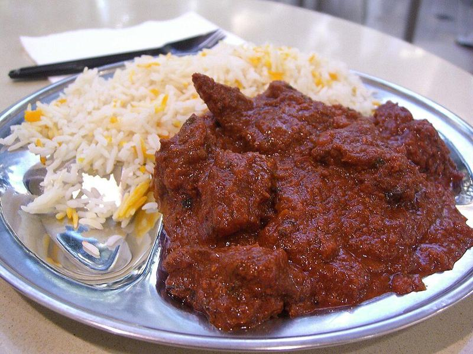

# Goan-Style Chicken Vindaloo

Photo: Alpha from Melbourne, Australia · CC BY-SA 2.0 · [source](https://commons.wikimedia.org/wiki/File:Beef_Vindaloo_-_Chilli_Mama,_Chadstone_(3014236693).jpg)

**Dinner** · Indian · 90 min · serves 4 · skill 2/3

> Chicken and potatoes braised in a fiery, tangy paste of dried chilies, garlic and vinegar. It's sharp and bold, with no cream at all, and the opposite of a mellow butter chicken.

| Per serving | kcal | Protein | Carbs | Fat | Fiber | Sodium | Cost |
| --- | --- | --- | --- | --- | --- | --- | --- |
| | 775 | 54 g | 92 g | 21 g | 6 g | 530 mg | $3.04 |

Contains: spicy

## Ingredients

- 2 lb boneless thighs, in 1½-inch pieces
- 2 onions, thinly sliced
- 8 garlic cloves
- 2-inch piece ginger
- 1 lb baby potatoes, halved
- a handful of cilantro
- 1½ cups basmati rice

From the pantry: ⅓ cup cider or white vinegar, 2 tbsp Kashmiri chili powder or paprika, 1 tsp cayenne, 1 tsp cumin, 1 tsp mustard seeds, 1 tsp turmeric, ½ tsp ground cinnamon, ¼ tsp ground cloves, 1 tsp black pepper, 1 tbsp brown sugar, 3 tbsp oil, salt

## Steps

1. Blend the vinegar, garlic, ginger, chili powder, cayenne, cumin, turmeric, cinnamon, cloves, pepper, brown sugar and 1½ tsp salt into a smooth paste. Toss with the chicken and marinate at least 30 minutes, or overnight in the fridge.
2. Heat the oil in a heavy pot over medium. Add the mustard seeds and when they pop, add the onions. Cook, stirring, until deep golden, 12 to 15 minutes.
3. Add the chicken and all its marinade and cook, stirring, until the paste darkens and smells toasty, 5 minutes.
4. Add the potatoes and 1 cup water, bring to a simmer, cover and cook on low until the potatoes are tender and the chicken is 175°F and tender, 25 to 30 minutes. Start the rice meanwhile.
5. Uncover and simmer a few minutes until the sauce clings. Taste: it should be hot, tangy and a touch sweet, so adjust with salt, vinegar or sugar. Serve over rice with cilantro.

**Tip:** Kashmiri chili powder gives vindaloo its brick-red color without overwhelming heat. Turn the heat up or down with the cayenne.

## Storing

Fridge 5 days · freezer up to 3 months. Reheat on the stove until bubbling. Like most vinegar curries, it's better on day two.

## Other ways to make it

- Steak
- Shrimp
- Pork
- Tofu
