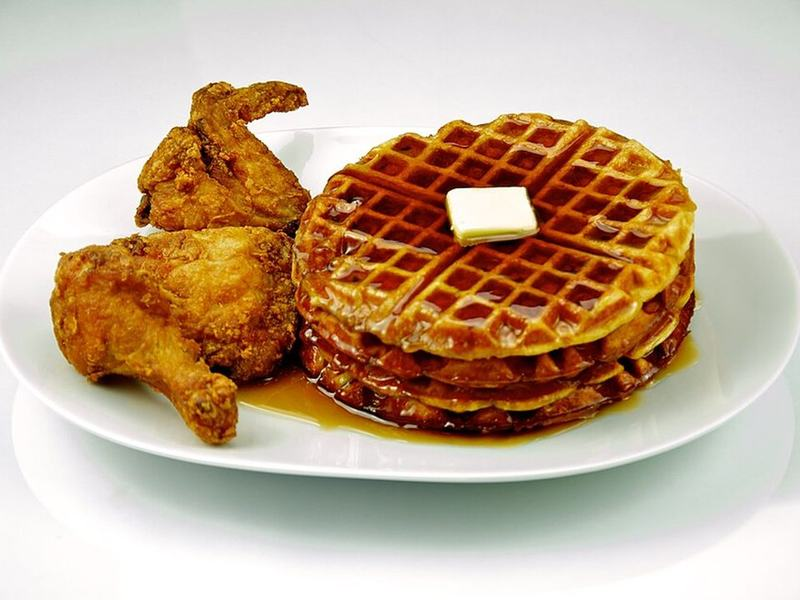

# Crispy Buttermilk Chicken & Waffles with Hot Honey

Photo: Evan Swigart, TheCulinaryGeek from Chicago, USA · CC BY 2.0 · [source](https://commons.wikimedia.org/wiki/File:Chicken_and_Waffles_201_-_Evan_Swigart.jpg)

**Breakfast** · Southern & Cajun · 60 min · serves 4 · skill 3/3

> Buttermilk-marinated fried chicken with a craggy, crunchy crust on golden waffles, all drizzled with honey spiked with hot sauce and chile.

| Per serving | kcal | Protein | Carbs | Fat | Fiber | Sodium | Cost |
| --- | --- | --- | --- | --- | --- | --- | --- |
| | 685 | 37 g | 65 g | 31 g | 1 g | 690 mg | $1.76 |

Contains: gluten, egg, dairy, spicy

## Ingredients

- 1 lb boneless chicken thighs, cut into 8 strips
- 3 cups buttermilk (1½ for the chicken, 1½ for the waffles)
- 1½ cups all-purpose flour, for the waffles
- 2 eggs
- 3 tbsp butter, melted
- 3 tbsp honey

From the pantry: 1 cup flour, for dredging, oil for frying, 1 tbsp sugar, 2 tsp baking powder, ½ tsp baking soda, 1 tsp smoked paprika, 1 tsp garlic powder, ½ tsp cayenne, 2 tbsp hot sauce, ½ tsp red pepper flakes, 1½ tsp salt

## Steps

1. Soak the chicken in 1½ cups buttermilk with 1 tbsp hot sauce and ½ tsp salt for at least 20 minutes or up to overnight in the fridge.
2. Whisk the dredging flour with the paprika, garlic powder, cayenne and ½ tsp salt. Lift the chicken from the buttermilk, drizzle 2 tbsp of the marinade into the flour and rub it in to make little clumps, then press each strip into the flour to coat well.
3. Heat 1 inch of oil in a heavy pot to 350°F. Fry the chicken in batches until deep golden and 175°F inside, 5 to 6 minutes, turning once. Drain on a rack and sprinkle with salt.
4. For the waffles, whisk the 1½ cups flour, sugar, baking powder, baking soda and ½ tsp salt, then stir in 1½ cups buttermilk, the eggs and melted butter. Cook in a hot waffle iron until golden and crisp, 4 to 5 minutes each.
5. Warm the honey with the remaining hot sauce and the pepper flakes. Top each waffle with chicken and drizzle with the hot honey.

**Tip:** Rubbing a little buttermilk into the dredge creates shaggy bits that fry up into an extra-crunchy crust.

## Storing

Fridge 3 days · freezer up to 2 months. Store chicken and waffles separately. Re-crisp both in a 400°F oven or air fryer, 6 to 8 minutes.

## Other ways to make it

- Steak
- Shrimp
- Pork
- Tofu
