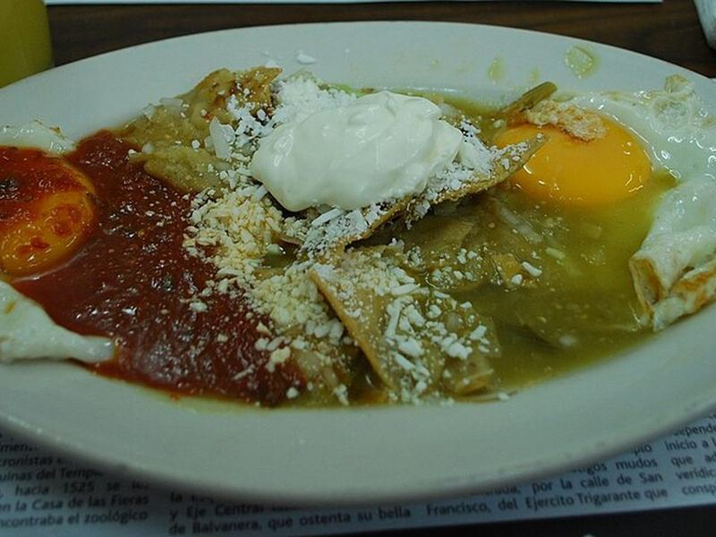

# Chilaquiles Verdes with Fried Eggs

Photo: AlejandroLinaresGarcia · CC BY-SA 4.0 · [source](https://commons.wikimedia.org/wiki/File:CafeLaBlanca12.JPG)

**Breakfast** · Mexican · 20 min · serves 4 · skill 1/3

> Tortilla chips simmered briefly in tangy salsa verde so they're half crisp, half saucy, then crowned with fried eggs, crema, onion and cotija.

| Per serving | kcal | Protein | Carbs | Fat | Fiber | Sodium | Cost |
| --- | --- | --- | --- | --- | --- | --- | --- |
| | 650 | 17 g | 56 g | 41 g | 9 g | 2070 mg | $2.15 |

Contains: egg, dairy

## Ingredients

- 8 oz sturdy tortilla chips
- 24 oz salsa verde
- ½ cup broth or water
- 4 eggs
- sour cream
- cotija or feta
- ¼ onion, thinly sliced
- cilantro
- 1 avocado

From the pantry: 2 tbsp oil, salt

## Steps

1. Simmer the salsa verde and broth in a large skillet for 3 minutes.
2. Add the chips and toss gently until coated, about 1 minute. They should still have some crunch.
3. Fry the eggs in a separate pan in the oil.
4. Top the chips with the eggs, a drizzle of sour cream, cheese, onion, cilantro and avocado.
5. Serve straight away. Chilaquiles wait for no one.

**Tip:** Use thick restaurant-style chips. Thin ones dissolve in the sauce.

## Storing

Fridge 0 days · freezer not recommended. Best made fresh. The chips go soft quickly.

