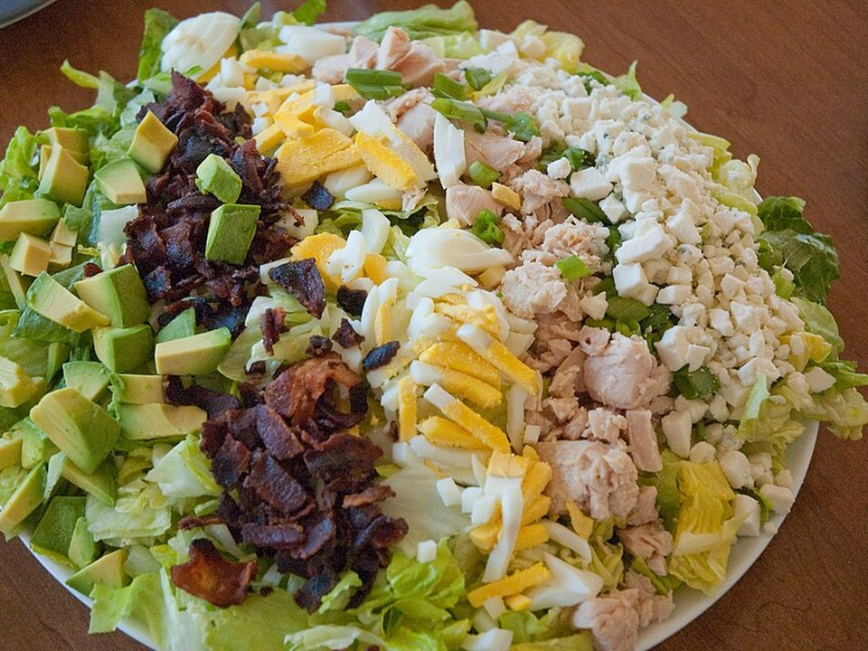

# Classic Cobb Salad

Photo: Jodimichelle · CC BY-SA 2.0 · [source](https://commons.wikimedia.org/wiki/File:Cobb_salad,_15_October_2010.jpg)

**Lunch** · American comfort · 25 min · serves 4 · skill 1/3

> Rows of chicken, crispy bacon, jammy eggs, avocado, tomatoes and blue cheese or feta over crisp romaine, with a tangy red wine vinaigrette.

| Per serving | kcal | Protein | Carbs | Fat | Fiber | Sodium | Cost |
| --- | --- | --- | --- | --- | --- | --- | --- |
| | 650 | 38 g | 16 g | 51 g | 9 g | 1270 mg | $3.73 |

Contains: egg, dairy, pork

## Ingredients

- 3 cups chopped chicken
- 8 slices bacon, cooked and crumbled
- 4 eggs, boiled 9 minutes
- 2 avocados
- 1 pint cherry tomatoes
- 3 romaine hearts
- ½ cup blue cheese or feta

From the pantry: Vinaigrette: ⅓ cup olive oil, 3 tbsp red wine vinegar, 1 tsp Dijon, 1 small garlic clove, salt, pepper

## Steps

1. Cook the bacon until crisp and crumble it. Boil the eggs 9 minutes, ice, peel and chop.
2. Shake the vinaigrette ingredients in a jar.
3. Chop the romaine and spread on a platter.
4. Arrange the chicken, bacon, eggs, avocado, tomatoes and cheese in rows on top.
5. Drizzle with dressing and toss at the table.

**Tip:** For packed lunches, layer the toppings in jars with the dressing on the bottom and lettuce on top.

## Storing

Fridge 3 days · freezer not recommended. Store dressing separately. Add avocado the day you eat it.

## Other ways to make it

- Shrimp
- Ground beef
- Black beans (veg)
