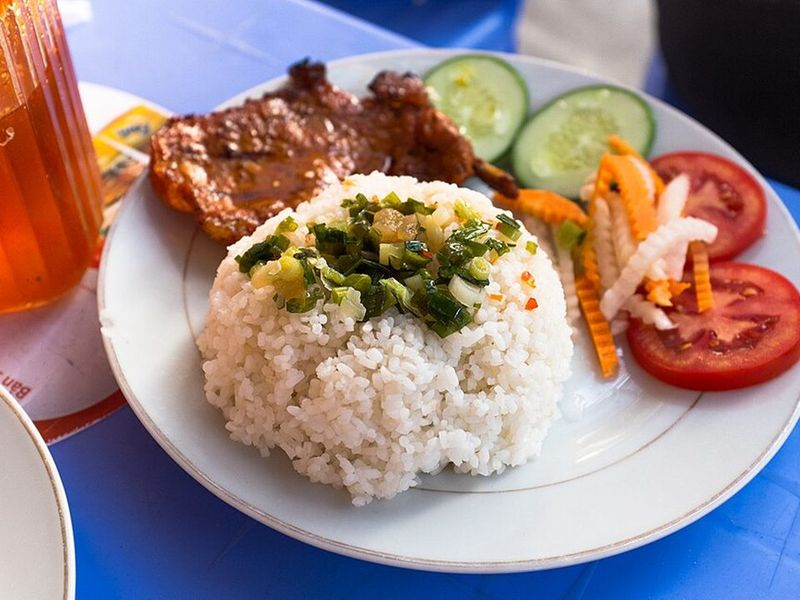

# Cơm Tấm Sườn Nướng (Lemongrass Pork Chops & Rice)

Photo: Christopher Crouzet · CC BY-SA 4.0 · [source](https://commons.wikimedia.org/wiki/File:C%C6%A1m_T%E1%BA%A5m,_Da_Nang,_Vietnam.jpg)

**Dinner** · Vietnamese · 75 min · serves 4 · skill 2/3

> Saigon's favorite plate: sweet, caramelized lemongrass pork chops over rice with a fried egg, scallion oil, quick-pickled carrots, cucumber and tomato, plus a little bowl of nước chấm to pour over everything.

| Per serving | kcal | Protein | Carbs | Fat | Fiber | Sodium | Cost |
| --- | --- | --- | --- | --- | --- | --- | --- |
| | 820 | 51 g | 88 g | 30 g | 3 g | 2530 mg | $3.15 |

Contains: fish, egg, gluten, spicy, shellfish

## Ingredients

- 1½ lb thin boneless pork chops
- 2 tbsp lemongrass paste
- 4 garlic cloves, minced
- 6 tbsp fish sauce, divided
- 2 tbsp soy sauce
- 1 tbsp oyster sauce
- 1 tbsp honey
- 4 green onions, thinly sliced
- 4 eggs
- 2 carrots, in matchsticks
- 1 cucumber, sliced
- 2 Roma tomatoes, sliced
- 1 lime, juiced
- 1 jalapeño or Thai chile, minced
- 1½ cups jasmine rice

From the pantry: ¼ cup oil, 4 tbsp sugar, 1 tbsp brown sugar, ¼ cup rice vinegar, ½ tsp black pepper, salt

## Steps

1. Mix the lemongrass, half the garlic, 2 tbsp fish sauce, the soy sauce, oyster sauce, honey, brown sugar, pepper and 1 tbsp oil. Coat the chops and marinate 30 minutes, or overnight in the fridge.
2. Toss the carrots with the vinegar, 1 tbsp sugar and a pinch of salt to quick-pickle. For nước chấm, stir 4 tbsp fish sauce, 3 tbsp sugar, the lime juice, ½ cup warm water, the chile and the remaining garlic.
3. Start the rice. Heat 2 tbsp oil until shimmering and pour it over the green onions with a pinch of salt for scallion oil.
4. Cook the chops on a hot grill or in a cast-iron skillet over medium-high, 3 to 4 minutes per side, until charred at the edges and 145°F inside. Rest 5 minutes, then slice.
5. Fry the eggs in the remaining oil. Serve the pork over rice with an egg, scallion oil, pickles, cucumber and tomato, and nước chấm on the side.

**Tip:** Real cơm tấm uses broken rice, which you can find cheaply at Asian markets and cook like jasmine rice. Bone-in thin chops are traditional and stay juicier.

Adapted from [Cooking Therapy](https://www.cooking-therapy.com/com-suon-lemongrass-pork/).

## Storing

Fridge 3 days · freezer up to 2 months. Freeze marinated raw chops. Reheat cooked pork in a skillet or a 375°F oven for 6 to 8 minutes.

