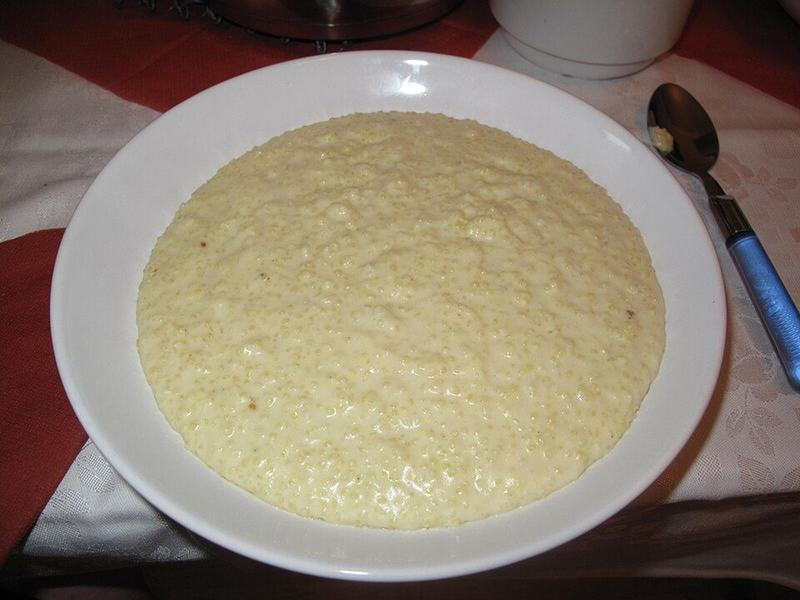

# Jamaican Spiced Cornmeal Porridge

Photo: Dezidor · CC BY 3.0 · [source](https://commons.wikimedia.org/wiki/File:J%C3%A1hlov%C3%A1_ka%C5%A1e.jpg)

**Breakfast** · Caribbean & Latin · 25 min · serves 4 · skill 1/3

> Velvety, warming cornmeal simmered in coconut milk and milk with cinnamon, nutmeg and vanilla, then sweetened with condensed milk the way Jamaican grannies make it.

| Per serving | kcal | Protein | Carbs | Fat | Fiber | Sodium | Cost |
| --- | --- | --- | --- | --- | --- | --- | --- |
| | 415 | 10 g | 61 g | 17 g | 4 g | 390 mg | $0.62 |

Contains: dairy

## Ingredients

- 1 cup fine yellow cornmeal
- 2 cups milk
- ½ can coconut milk
- ⅓ cup sweetened condensed milk, or to taste
- 2 bananas, sliced, for topping

From the pantry: 1 tsp cinnamon, ½ tsp nutmeg, 1 tsp vanilla, ½ tsp salt

## Steps

1. Whisk the cornmeal into 1 cup cold water in a bowl until smooth; this stops lumps.
2. Bring 2 cups water, the milk, coconut milk, cinnamon and salt to a simmer in a heavy saucepan over medium.
3. Whisking constantly, pour in the cornmeal mixture. Keep whisking until it thickens, 2 to 3 minutes.
4. Turn the heat to low, cover and cook, stirring every few minutes, until the cornmeal is soft with no grit, 12 to 15 minutes. Add a splash of water if it gets too thick.
5. Stir in the nutmeg, vanilla and condensed milk. Serve hot topped with sliced banana.

**Tip:** Always mix the cornmeal with cold water first. Pouring dry cornmeal straight into hot liquid makes lumps that won't whisk out.

## Storing

Fridge 4 days · freezer not recommended. It sets firm when cold. Reheat over low with a splash of milk, whisking until smooth.

