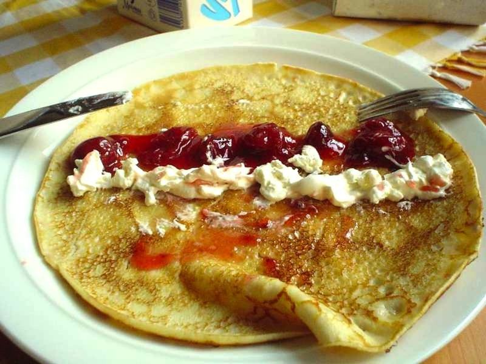

# French Crêpes with Berries, Yogurt & Nutella

Photo: Unknown · CC BY-SA 3.0 · [source](https://commons.wikimedia.org/wiki/File:Cr%C3%AApe_opened_up.jpg)

**Breakfast** · French · 35 min · serves 4 · skill 2/3

> Paper-thin, lacy-edged crêpes from a quick blender batter, folded around tangy Greek yogurt and fresh blueberries or a warm swipe of Nutella. Twelve crêpes, three each.

| Per serving | kcal | Protein | Carbs | Fat | Fiber | Sodium | Cost |
| --- | --- | --- | --- | --- | --- | --- | --- |
| | 510 | 19 g | 61 g | 22 g | 3 g | 480 mg | $1.66 |

Contains: gluten, egg, dairy, nuts

## Ingredients

- 1 cup all-purpose flour
- 1½ cups milk
- 3 eggs
- 3 tbsp butter, melted, plus more for the pan
- 1 pint fresh blueberries
- 1 cup plain Greek yogurt
- ⅓ cup Nutella

From the pantry: 2 tbsp sugar, 1 tsp vanilla, pinch of salt

## Steps

1. Blend the flour, milk, eggs, melted butter, sugar, vanilla and salt until smooth, about 15 seconds. Let the batter rest 15 minutes (or overnight in the fridge) so the crêpes are tender.
2. Heat an 8- to 10-inch nonstick skillet over medium and brush with a little butter. Pour in 3 tbsp batter and immediately swirl the pan to coat the bottom thinly.
3. Cook until the edges turn lacy and golden and lift easily, about 1 minute. Flip with a spatula or your fingers and cook 20 to 30 seconds more.
4. Stack the crêpes on a plate under a towel as you go; you should get about 12.
5. Fill each with a spoonful of yogurt and berries or a thin spread of Nutella, then fold into quarters or roll up.

**Tip:** The first crêpe is always a tester. Use it to judge the heat and how much batter your pan needs, then adjust.

## Storing

Fridge 3 days · freezer up to 2 months. Stack unfilled crêpes with parchment between and wrap. Warm in a skillet 20 seconds per side or microwave briefly.

