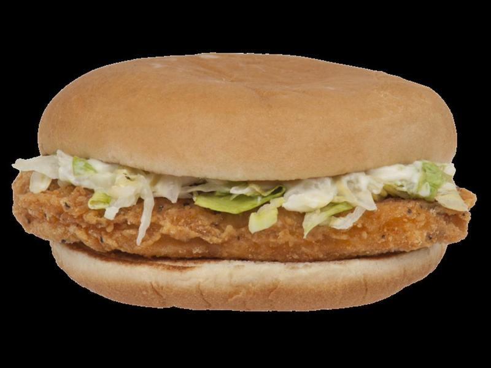

# Hot Honey Crispy Chicken Sandwiches

Photo: Evan-Amos · Public domain · [source](https://commons.wikimedia.org/wiki/File:McD-McChicken_(transparent).png)

**Dinner** · Southern & Cajun · 40 min · serves 4 · skill 2/3

> Buttermilk-brined chicken thighs fried until craggy and crunchy, drizzled with chili-spiked hot honey and stacked with slaw and pickles on brioche.

| Per serving | kcal | Protein | Carbs | Fat | Fiber | Sodium | Cost |
| --- | --- | --- | --- | --- | --- | --- | --- |
| | 655 | 43 g | 62 g | 26 g | 3 g | 1270 mg | $2.34 |

Contains: dairy, gluten, egg, spicy

## Ingredients

- 1½ lb boneless thighs (4 large)
- 1 cup milk plus 1 tbsp lemon juice
- 4 brioche buns
- ⅓ cup honey
- 2 cups coleslaw mix
- pickle chips

From the pantry: 1½ cups flour, 2 tbsp cornstarch, 2 tsp paprika, 1 tsp each garlic powder, cayenne, salt; oil for frying; 2 tsp chili flakes; mayo

## Steps

1. Soak the chicken in the milk, lemon juice and 1 tsp salt for at least 30 minutes.
2. Mix the flour, cornstarch, paprika, garlic powder, cayenne and 1 tsp salt. Drizzle in 3 tbsp of the soaking milk and rub it in to make shaggy clumps. That's the craggy crust.
3. Dredge each thigh firmly. Fry in 1 inch of 350°F oil until deep golden and 175°F inside, 5 to 6 minutes per side. Drain on a rack.
4. Warm the honey with the chili flakes. Toss the slaw with a spoon of mayo and salt.
5. Toast the buns, spread with mayo, add the chicken, drizzle generously with hot honey, then slaw and pickles.

**Tip:** Thighs stay juicy even if you overshoot the cooking time. Breasts don't.

## Storing

Fridge 3 days · freezer up to 2 months. Re-crisp chicken at 400°F or in an air fryer for 8 minutes. Build sandwiches fresh.

## Other ways to make it

- Steak
- Shrimp
- Pork
- Tofu
