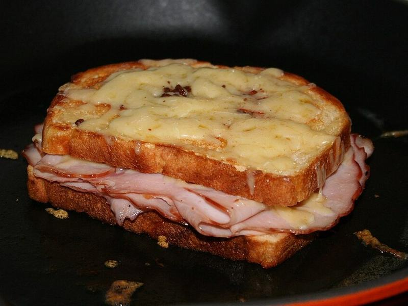

# Croque Monsieur

Photo: Michael Brewer · CC BY-SA 2.5 · [source](https://commons.wikimedia.org/wiki/File:Croque_monsieur.jpg)

**Lunch** · French & Spanish · 25 min · serves 4 · skill 1/3

> Paris café classic: ham and Gruyère on toasted bread, smothered in creamy béchamel and broiled until bubbly and golden.

| Per serving | kcal | Protein | Carbs | Fat | Fiber | Sodium | Cost |
| --- | --- | --- | --- | --- | --- | --- | --- |
| | 645 | 40 g | 42 g | 35 g | 2 g | 1750 mg | $3.31 |

Contains: pork, dairy, gluten

## Ingredients

- 8 slices sourdough or pain de mie
- 9 oz sliced ham
- 9 oz Gruyère, shredded
- 3 tbsp butter
- 1¼ cups milk

From the pantry: 2 tbsp flour, 2 tsp Dijon, nutmeg, salt, pepper

## Steps

1. Make béchamel: melt 2 tbsp butter, whisk in the flour for 1 minute, then the milk. Simmer until thick, 3 minutes. Season with nutmeg, salt and pepper and stir in a handful of Gruyère.
2. Spread 4 slices of bread with Dijon, top with ham and Gruyère, and close the sandwiches.
3. Toast the sandwiches in the remaining butter until golden on both sides.
4. Move to a sheet pan, spread the tops with béchamel and scatter with the rest of the cheese.
5. Broil 2 to 3 minutes until bubbling and browned.

**Tip:** Add a fried egg on top and it becomes a croque madame.

## Storing

Fridge 1 days · freezer not recommended. Best fresh. Reheat at 375°F for 8 minutes.

