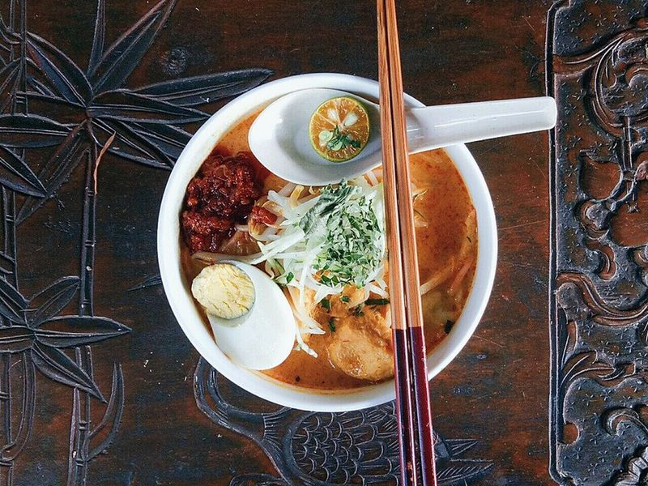

# Curry Laksa with Chicken & Tofu

Photo: Giddy98 · CC BY-SA 4.0 · [source](https://commons.wikimedia.org/wiki/File:Nyonya_Laksa.jpg)

**Dinner** · Malaysian & Singaporean · 50 min · serves 4 · skill 2/3

> A rich, spicy coconut curry noodle soup from Malaysia and Singapore, with tender chicken, golden tofu, rice noodles and a crunchy tangle of bean sprouts, finished with lime and cilantro.

| Per serving | kcal | Protein | Carbs | Fat | Fiber | Sodium | Cost |
| --- | --- | --- | --- | --- | --- | --- | --- |
| | 820 | 48 g | 57 g | 45 g | 4 g | 2250 mg | $4.03 |

Contains: spicy, fish, shellfish

## Ingredients

- 1½ lb boneless chicken thighs
- ½ cup laksa paste
- 1 can coconut milk
- 4 cups chicken broth
- 7 oz extra-firm tofu, cubed
- 7 oz rice vermicelli
- 6 oz bean sprouts
- 1 tbsp lemongrass paste
- 1 tsp grated ginger
- 2 garlic cloves, minced
- 1 tbsp fish sauce
- 2 limes, in wedges
- cilantro leaves

From the pantry: 2 tbsp oil, 1 tsp sugar, salt

## Steps

1. Simmer the chicken in the broth in a covered pot for 15 minutes until cooked through (165°F). Lift it out, shred it and keep the broth.
2. Fry the tofu in 1 tbsp oil in a skillet over medium-high until golden on most sides, about 5 minutes. Set aside.
3. In the soup pot, heat the remaining oil over medium-low and cook the garlic, ginger and lemongrass for 1 minute. Add the laksa paste and fry, stirring, until fragrant and darker, 2 to 3 minutes.
4. Whisk in the broth, coconut milk, fish sauce and sugar, cover and simmer 10 minutes. Add the tofu and let it soak up the broth. Taste and adjust with salt, fish sauce or lime.
5. Soak or cook the noodles as the package directs and drain. Divide among bowls, top with chicken, ladle over the hot soup and finish with bean sprouts, cilantro and lime.

**Tip:** Tofu puffs from an Asian market are traditional because they soak up the broth like sponges. Laksa pastes vary in heat and salt, so start with ⅓ cup and add more after tasting.

Adapted from [RecipeTin Eats](https://www.recipetineats.com/laksa-soup/).

## Storing

Fridge 3 days · freezer up to 2 months. Freeze the broth only. Store noodles separately and pour reheated soup over them.

