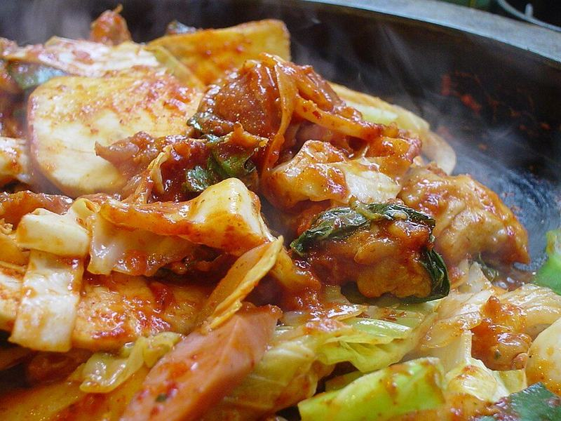

# Dakgalbi (Spicy Korean Chicken & Cabbage Stir-Fry)

Photo: by shizu k (shezzz) at Flickr · CC BY-SA 2.0 · [source](https://commons.wikimedia.org/wiki/File:Korean_cuisine-Dakgalbi-01.jpg)

**Dinner** · Korean · 45 min · serves 4 · skill 1/3

> Gochujang-marinated chicken stir-fried with sweet cabbage, sweet potato and onion until sticky and fiery-red. It's a Korean favorite to share straight from the pan.

| Per serving | kcal | Protein | Carbs | Fat | Fiber | Sodium | Cost |
| --- | --- | --- | --- | --- | --- | --- | --- |
| | 795 | 55 g | 99 g | 19 g | 7 g | 1140 mg | $3.22 |

Contains: gluten, sesame, spicy

## Ingredients

- 2 lb boneless thighs, in 1½-inch pieces
- ¼ cup gochujang
- 3 tbsp soy sauce
- 1 tbsp honey
- 6 garlic cloves, grated
- 2 tsp grated ginger
- ½ head green cabbage, in 2-inch pieces
- 1 medium sweet potato, in ¼-inch half-moons
- 1 onion, sliced
- 4 green onions, in 2-inch lengths
- 1 tbsp sesame seeds
- 1½ cups short-grain or jasmine rice

From the pantry: 2 tbsp gochugaru or 1 tsp red pepper flakes, 1 tsp curry powder, 1 tbsp sugar, 2 tbsp oil, 1 tsp sesame oil, pepper

## Steps

1. Mix the gochujang, soy sauce, honey, gochugaru, curry powder, sugar, garlic, ginger and a few grinds of pepper. Toss with the chicken and marinate at least 15 minutes, or up to overnight in the fridge.
2. Start the rice. Heat the oil in a large skillet or wide pan over medium-high heat. Add the sweet potato and onion and cook 3 minutes, until they start to soften.
3. Add the chicken with all its marinade and spread it out. Cook, stirring every minute or so, for 5 minutes.
4. Add the cabbage, toss and keep cooking over medium-high, stirring often, until the chicken reaches 165°F, the sweet potato is tender and the cabbage is wilted but still a bit crisp, 8 to 10 minutes. Add a splash of water if the sauce starts to scorch.
5. Toss in the green onions and sesame oil, sprinkle with sesame seeds and serve from the pan with rice.

**Tip:** When most of it is gone, add a scoop of rice and a little kimchi to the leftover sauce in the pan and fry it until crisp. That's how it's finished in Korea.

## Storing

Fridge 3 days · freezer up to 2 months. Reheat in a skillet over medium heat with a splash of water, 4 to 5 minutes.

## Other ways to make it

- Steak
- Shrimp
- Pork
- Tofu
