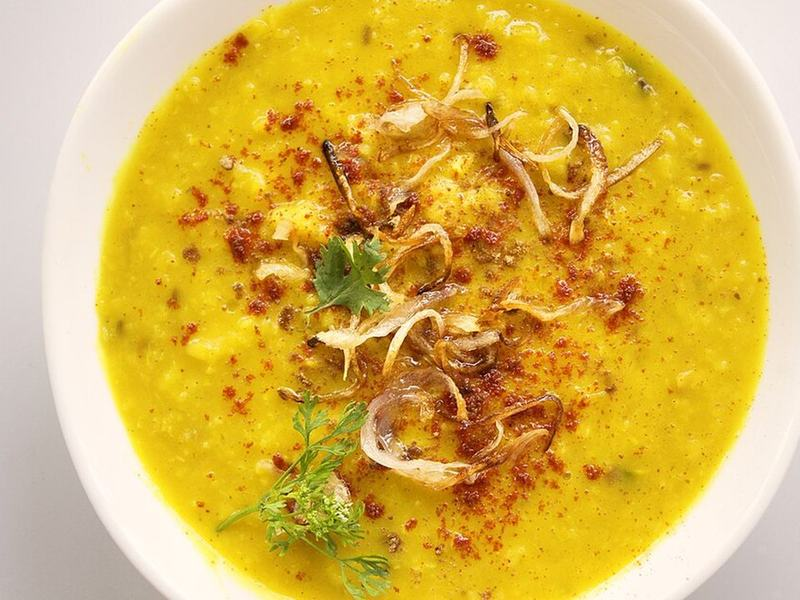

# Dal Tadka (Spiced Red Lentils)

Photo: Bharat Mirchandani from Mumbai, India · CC BY-SA 2.0 · [source](https://commons.wikimedia.org/wiki/File:Dal_Tadka_01_(36779549481).jpg)

**Dinner** · Indian · 35 min · serves 4 · skill 1/3

> Creamy, soothing red lentils finished with a sizzling tadka of butter, garlic, cumin and chili poured over at the table.

| Per serving | kcal | Protein | Carbs | Fat | Fiber | Sodium | Cost |
| --- | --- | --- | --- | --- | --- | --- | --- |
| | 575 | 22 g | 99 g | 10 g | 11 g | 350 mg | $1.17 |

Contains: dairy

## Ingredients

- 1½ cups red lentils, rinsed
- 1 onion, diced
- 2 tomatoes, chopped
- 6 garlic cloves, sliced
- 1-inch ginger
- 1 green chili
- 2 tbsp butter or ghee
- cilantro
- 1 lemon
- 1½ cups basmati rice

From the pantry: 1 tsp turmeric, 2 tsp cumin seeds, ½ tsp chili flakes, 1 tbsp oil, salt

## Steps

1. Simmer the lentils with 4 cups water, the turmeric and 1 tsp salt until soft and creamy, 20 minutes, whisking now and then. Start the rice.
2. Cook the onion, ginger and chili in the oil until golden, then add the tomatoes and cook to a jammy paste. Stir into the lentils.
3. Simmer 5 minutes, thinning with water to a pourable consistency. Season with lemon.
4. For the tadka, heat the butter until foaming and add the cumin seeds, sliced garlic and chili flakes. Sizzle until the garlic is golden.
5. Pour the sizzling tadka over the dal, top with cilantro and serve with rice.

**Tip:** Cheap, high-fiber and freezer-friendly. One of the best budget dinners there is.

## Storing

Fridge 5 days · freezer up to 3 months. Thickens as it sits. Reheat with a splash of water.

