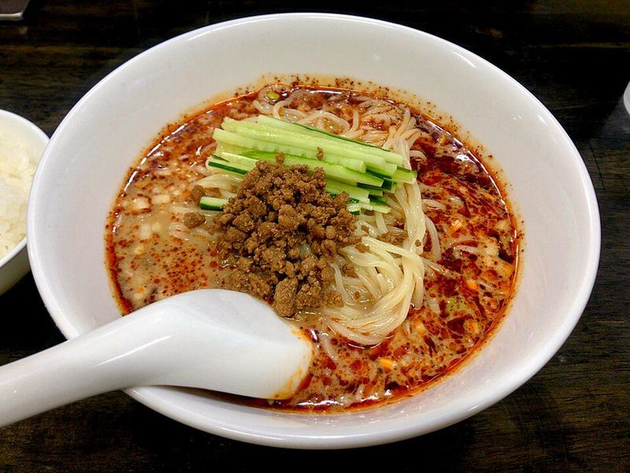

# Dan Dan Noodles

Photo: KKPCW · CC BY-SA 4.0 · [source](https://commons.wikimedia.org/wiki/File:%E5%86%B7%E3%82%84%E3%81%97%E6%8B%85%E3%80%85%E9%BA%BA.jpg)

**Dinner** · Sichuan & Hunan · 25 min · serves 4 · skill 2/3

> Springy noodles over a nutty, spicy sesame-chili sauce, topped with crispy savory pork and tender bok choy.

| Per serving | kcal | Protein | Carbs | Fat | Fiber | Sodium | Cost |
| --- | --- | --- | --- | --- | --- | --- | --- |
| | 885 | 38 g | 81 g | 47 g | 7 g | 1240 mg | $2.35 |

Contains: pork, gluten, nuts, sesame, spicy

## Ingredients

- 12 oz noodles (ramen, lo mein or spaghetti)
- 1 lb ground pork
- 2 tbsp hoisin
- ¼ cup soy sauce
- 3 tbsp tahini or peanut butter
- 3 tbsp chili crisp
- 3 garlic cloves
- 1 lb baby bok choy, halved
- crushed peanuts
- green onions

From the pantry: 1 tbsp oil, 1 tbsp rice vinegar, 1 tsp sugar

## Steps

1. Brown the pork in the oil until well crisped, 8 minutes. Stir in the hoisin and 1 tbsp soy and cook 1 minute more.
2. Whisk the tahini, remaining soy, chili crisp, vinegar, sugar, grated garlic and 3 tbsp hot water into a sauce. Divide among bowls.
3. Boil the noodles, adding the bok choy for the last 2 minutes. Drain, saving a splash of water.
4. Add noodles and bok choy to the bowls, loosening the sauce with a little noodle water.
5. Top with the crispy pork, peanuts and green onions. Toss at the table.

**Tip:** Let the pork get properly crispy. The crunch is the point.

## Storing

Fridge 3 days · freezer up to 2 months. Store pork, sauce and noodles separately. Warm the pork, toss with fresh-boiled noodles.

## Other ways to make it

- Ground beef
- Ground turkey
- Italian sausage
- Lentils (veg)
