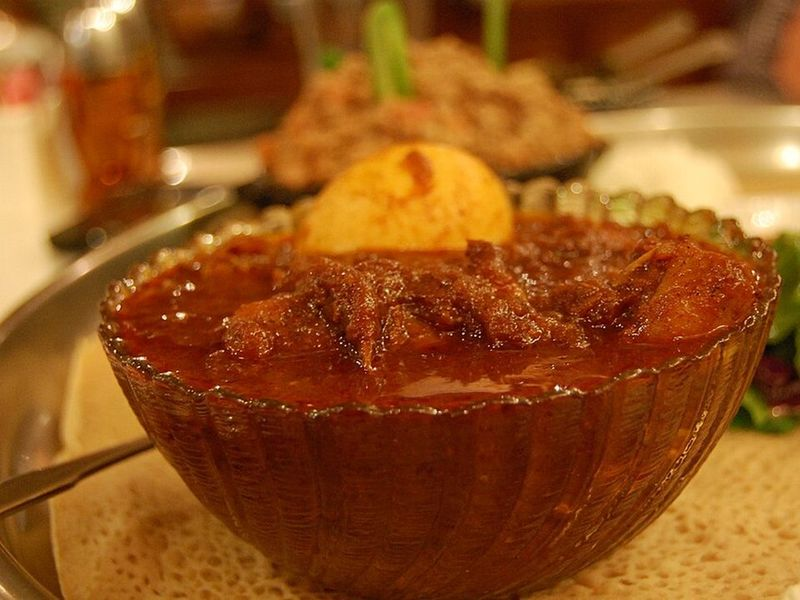

# Doro Wat (Berbere Chicken Stew with Eggs)

Photo: stu_spivack · CC BY-SA 2.0 · [source](https://commons.wikimedia.org/wiki/File:Ethiopian_wat.jpg)

**Dinner** · Ethiopian · 90 min · serves 4 · skill 2/3

> Ethiopia's celebration stew: a mountain of onions cooked down to a deep, sweet, brick-red sauce with berbere and spiced butter, holding tender chicken and whole eggs.

| Per serving | kcal | Protein | Carbs | Fat | Fiber | Sodium | Cost |
| --- | --- | --- | --- | --- | --- | --- | --- |
| | 845 | 59 g | 83 g | 30 g | 6 g | 750 mg | $3.62 |

Contains: spicy, dairy, egg

## Ingredients

- 2 lb onions, very finely chopped
- 2 lb boneless chicken thighs, halved
- 4 eggs, hard-boiled and peeled
- ¼ cup butter
- 3 tbsp berbere
- 4 garlic cloves, grated
- 1 tbsp grated ginger
- 1 lemon
- 1½ cups rice, or 4 to 6 store-bought injera

From the pantry: 1 tbsp oil, ½ tsp ground cardamom, ½ tsp ground cumin, ¼ tsp ground fenugreek, ¼ tsp turmeric, 1 tsp salt

## Steps

1. Toss the chicken with the lemon juice and a pinch of salt and set aside.
2. Put the onions in a dry Dutch oven over medium heat and cook, stirring often, until they collapse, turn jammy and start to color, 25 to 30 minutes. Add a spoonful of water if they catch.
3. Make quick spiced butter: melt the butter with the cardamom, cumin, fenugreek and turmeric over low heat for 2 minutes. Add it to the onions with the oil, garlic, ginger and berbere and fry, stirring, for 3 minutes until dark red and fragrant.
4. Stir in 1½ cups water, add the chicken, cover and simmer gently until the chicken is tender and 175°F inside, 25 to 30 minutes. Start the rice.
5. Score the eggs lightly, nestle them into the sauce and simmer uncovered 10 minutes until the sauce is thick enough to coat a spoon. Season with salt and serve with rice or injera.

**Tip:** Traditional doro wat uses bone-in drumsticks and niter kibbeh (Ethiopian spiced butter); both deepen the flavor. Store-bought injera is sold at Ethiopian markets and many Whole Foods, or warm thin crepes in a skillet as a shortcut.

Adapted from [Glebe Kitchen](https://glebekitchen.com/doro-wat-ethiopian-chicken-curry/).

## Storing

Fridge 4 days · freezer up to 3 months. Tastes even better the next day. Reheat on the stove over medium-low, 8 to 10 minutes; freeze without the eggs.

