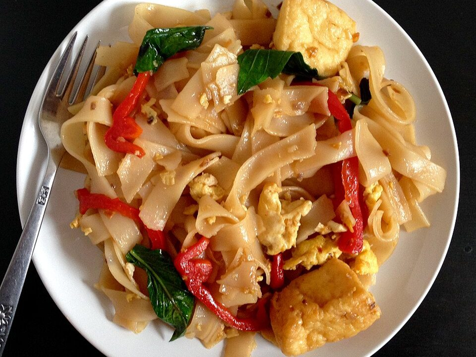

# Drunken Noodles (Pad Kee Mao)

Photo: Joy · CC BY 2.0 · [source](https://commons.wikimedia.org/wiki/File:Drunken_noodles_(pad_kee_mao).jpg)

**Dinner** · Thai · 30 min · serves 4 · skill 2/3

> Wide, chewy rice noodles wok-tossed with chicken, peppers, chilies and basil in a bold, savory-sweet sauce.

| Per serving | kcal | Protein | Carbs | Fat | Fiber | Sodium | Cost |
| --- | --- | --- | --- | --- | --- | --- | --- |
| | 570 | 36 g | 70 g | 17 g | 4 g | 1830 mg | $2.86 |

Contains: gluten, spicy, egg, fish, shellfish

## Ingredients

- 8 oz wide rice noodles
- 1 lb chicken, thinly sliced
- 2 bell peppers, sliced
- 1 onion, sliced
- 6 garlic cloves
- 1 to 2 chilies
- 3 tbsp oyster sauce
- 3 tbsp soy sauce
- 1 tbsp fish sauce
- 2 eggs
- a big handful of basil

From the pantry: 3 tbsp oil, 1 tbsp brown sugar

## Steps

1. Soak the noodles in hot water until pliable, about 20 minutes. Drain.
2. Mix the oyster sauce, soy, fish sauce, sugar and 2 tbsp water.
3. Stir-fry the garlic and chilies in the oil for 20 seconds, then the chicken until cooked, 4 minutes. Push aside and scramble the eggs.
4. Add the onion and peppers for 2 minutes, then the noodles and sauce. Toss with tongs until the noodles are tender and caramelized at the edges, 3 minutes.
5. Fold in the basil and serve right away.

**Tip:** Don't overcrowd the pan. Cook in two batches if your skillet is small.

## Storing

Fridge 3 days · freezer not recommended. Reheat in a skillet with a splash of water.

## Other ways to make it

- Steak
- Shrimp
- Pork
- Tofu
