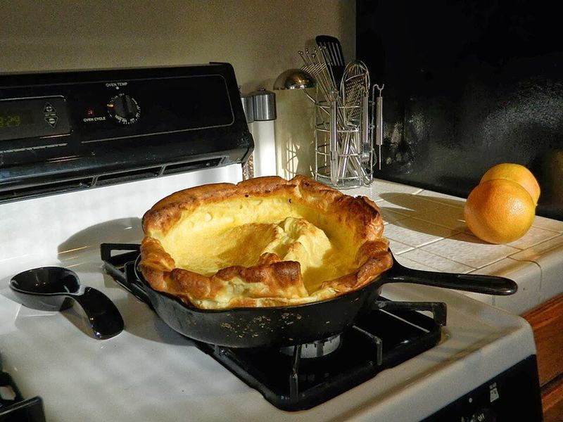

# Lemon Sugar Dutch Baby Pancake

Photo: Jengod · CC BY-SA 3.0 · [source](https://commons.wikimedia.org/wiki/File:Dutchbaby-DSCN8394.JPG)

**Breakfast** · American comfort · 30 min · serves 4 · skill 1/3

> A dramatic, oven-puffed pancake with tall crisp edges and a tender custardy center, finished with fresh lemon, powdered sugar, berries and yogurt.

| Per serving | kcal | Protein | Carbs | Fat | Fiber | Sodium | Cost |
| --- | --- | --- | --- | --- | --- | --- | --- |
| | 385 | 16 g | 42 g | 18 g | 3 g | 490 mg | $1.54 |

Contains: gluten, egg, dairy

## Ingredients

- 4 eggs, room temperature
- ⅔ cup all-purpose flour
- ⅔ cup milk, room temperature
- 4 tbsp butter
- 1 lemon, in wedges
- 1 pint fresh blueberries
- 1 cup plain Greek yogurt

From the pantry: 1 tbsp sugar, 2 tbsp powdered sugar, 1 tsp vanilla, pinch of salt

## Steps

1. Put the butter in a 12-inch cast-iron or oven-safe skillet and heat the oven to 425°F with the skillet inside.
2. Blend the eggs, flour, milk, sugar, vanilla and salt until completely smooth and frothy, 30 seconds.
3. When the butter has melted and is foaming (about 5 minutes; don't let it burn), take the skillet out, swirl the butter up the sides and pour the batter into the center.
4. Bake without opening the oven until puffed high and deep golden at the edges, 18 to 20 minutes.
5. It will sink as it cools, which is normal. Squeeze lemon over right away, dust with powdered sugar, cut into wedges and serve with berries and yogurt.

**Tip:** Room-temperature eggs and milk give the biggest puff. Set them out 30 minutes ahead, or warm the milk for 20 seconds in the microwave.

## Storing

Fridge 1 days · freezer not recommended. Best straight from the oven. Leftovers reheat in a 350°F oven for 5 minutes but won't puff again.

