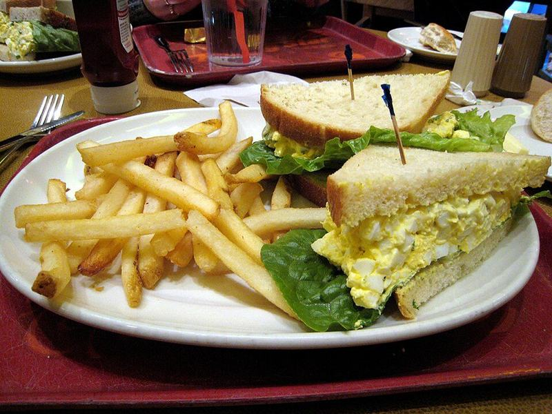

# Classic Egg Salad Sandwiches with Celery & Chives

Photo: jill, jellidonut... whatever from Raleigh, NC, USA · CC BY-SA 2.0 · [source](https://commons.wikimedia.org/wiki/File:Egg_salad_sandwich.jpg)

**Lunch** · American comfort · 25 min · serves 4 · skill 1/3

> Creamy, chunky egg salad with a little crunch from celery and a tangy Dijon kick, piled thick on soft wheat bread with crisp lettuce.

| Per serving | kcal | Protein | Carbs | Fat | Fiber | Sodium | Cost |
| --- | --- | --- | --- | --- | --- | --- | --- |
| | 455 | 24 g | 28 g | 28 g | 5 g | 1030 mg | $1.26 |

Contains: gluten, egg

## Ingredients

- 10 eggs
- 8 slices sandwich bread
- 2 celery stalks, finely diced
- 3 green onions or a handful of chives, sliced
- 1 romaine heart, leaves separated
- ¼ cup dill pickles, chopped

From the pantry: ⅓ cup mayo, 2 tsp Dijon mustard, 1 tsp lemon juice, ½ tsp paprika, salt, pepper

## Steps

1. Lower the eggs into a pot of boiling water and cook at a gentle boil for 11 minutes. Move them straight into ice water for 5 minutes, then peel.
2. Chop the eggs into small pieces, or mash roughly with a fork, leaving some chunks.
3. Fold in the mayo, Dijon, lemon juice, celery, green onions, pickles, paprika and a good pinch of salt and pepper. Taste and adjust.
4. Lay lettuce on 4 slices of bread, pile on the egg salad and top with the remaining bread.
5. Cut in half and serve, or wrap snugly for lunchboxes.

**Tip:** Eggs that are a week or so old peel much more easily than very fresh ones.

## Storing

Fridge 3 days · freezer not recommended. Keep the egg salad in a sealed container and make sandwiches the day you eat them.

