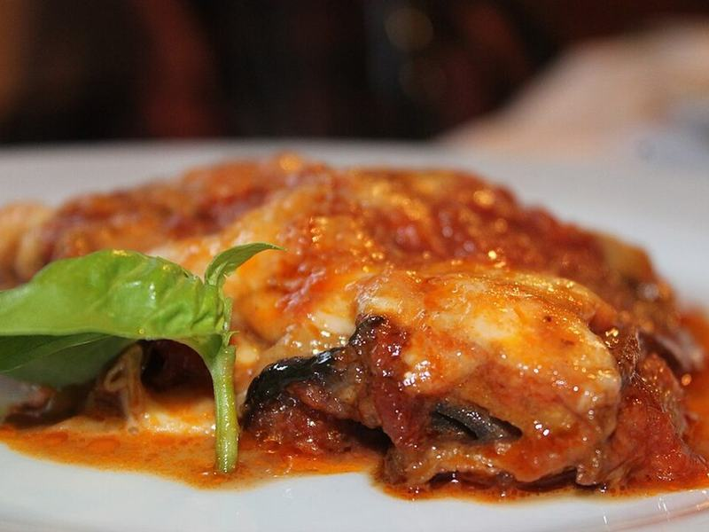

# Crispy Baked Eggplant Parmesan

Photo: Schellenberg · CC BY-SA 4.0 · [source](https://commons.wikimedia.org/wiki/File:Parmigiana_di_melanzane.jpg)

**Dinner** · Italian · 75 min · serves 4 · skill 2/3

> Panko-crusted eggplant slices oven-baked until crisp, then layered with marinara and bubbling mozzarella. All the comfort of the classic without a pot of frying oil.

| Per serving | kcal | Protein | Carbs | Fat | Fiber | Sodium | Cost |
| --- | --- | --- | --- | --- | --- | --- | --- |
| | 845 | 38 g | 82 g | 41 g | 15 g | 1970 mg | $3.61 |

Contains: gluten, dairy, egg

## Ingredients

- 2 large eggplants (about 2½ lb), in ½-inch rounds
- 3 eggs, beaten
- 2 cups panko
- 1 cup grated Parmesan, divided
- 24 oz marinara
- 2 cups shredded mozzarella
- fresh basil
- 5 oz spring mix, to serve

From the pantry: ½ cup flour, for coating, 5 tbsp olive oil, 1 tsp dried oregano, 1 tbsp red wine vinegar, 1 tsp salt, ½ tsp black pepper

## Steps

1. Heat the oven to 425°F and brush two sheet pans with the oil. Salt the eggplant slices and let them sit 15 minutes, then blot dry.
2. Set up three shallow bowls: the flour, the beaten eggs, and the panko mixed with half the Parmesan, the oregano and pepper. Coat each slice in flour, then egg, then the panko mix, pressing to help it stick.
3. Arrange on the pans, drizzle with any remaining oil and bake, flipping once, until deep golden and tender, 25 minutes. Lower the oven to 375°F.
4. Spread a little marinara in a 9x13 dish and layer the eggplant, marinara, mozzarella and remaining Parmesan in two layers, ending with cheese.
5. Bake until bubbling and browned on top, 20 to 25 minutes, Rest 10 minutes, then top with torn basil and serve with the greens dressed in a little olive oil and vinegar.

**Tip:** Leave the edges of the top layer of eggplant peeking out of the sauce so they stay crunchy.

## Storing

Fridge 4 days · freezer up to 2 months. Reheat covered at 350°F for 20 minutes, uncovering for the last 5 to re-crisp.

