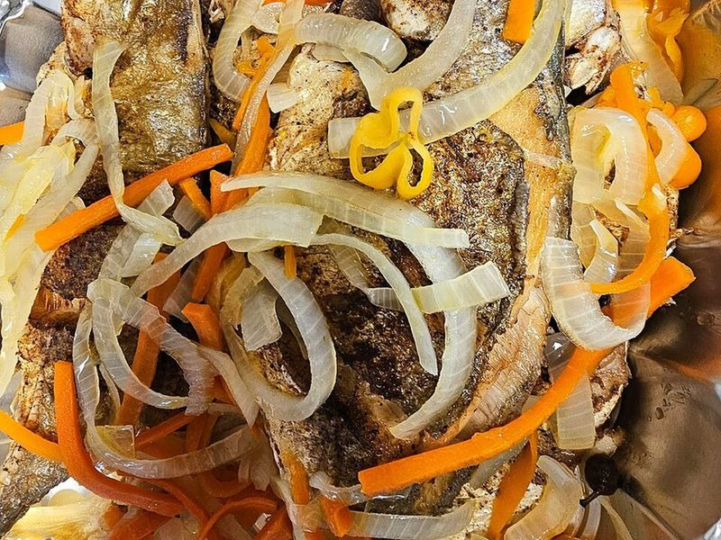

# Jamaican Escovitch Fish with Coconut Rice & Peas

Photo: Xaymacan · CC BY-SA 4.0 · [source](https://commons.wikimedia.org/wiki/File:Escoveitch_fish_Jamaica.jpg)

**Dinner** · Jamaican · 45 min · serves 4 · skill 2/3

> Crisp fried fish drenched in a hot, tangy pickle of onion, carrot, sweet pepper, allspice and scotch bonnet, served with coconut rice and peas and sweet plantain.

| Per serving | kcal | Protein | Carbs | Fat | Fiber | Sodium | Cost |
| --- | --- | --- | --- | --- | --- | --- | --- |
| | 835 | 44 g | 98 g | 31 g | 9 g | 620 mg | $3.46 |

Contains: fish, spicy, gluten

## Ingredients

- 1½ lb firm white fish fillets (snapper, tilapia or cod), in 4 pieces
- 1 lime
- 1 large onion, thinly sliced
- 1 carrot, in thin matchsticks
- 1 red or yellow bell pepper, thinly sliced
- 1 scotch bonnet pepper, thinly sliced
- 1 (15 oz) can red kidney beans, drained
- ½ can coconut milk
- 1½ cups long-grain white rice
- 1 ripe plantain

From the pantry: 1 cup white vinegar, 2 tsp brown sugar, 1 tsp whole allspice berries, ¼ cup flour for dredging, ½ cup oil for frying, 1 tsp dried thyme, salt, pepper

## Steps

1. Make the pickle: simmer the vinegar, ½ cup water, sugar, allspice and 1 tsp salt for 3 minutes. Pour over the onion, carrot, bell pepper and scotch bonnet in a bowl and let it sit while you cook (or up to a day ahead).
2. For rice and peas, combine the rice, beans, coconut milk, thyme, 1 tsp salt and enough water to make 2¾ cups liquid in a pot. Bring to a boil, cover and cook on low for 18 minutes, then rest 5 minutes.
3. Rub the fish with lime juice, pat dry, season well with salt and pepper and dust with the flour. Slice the plantain on the diagonal.
4. Heat the oil in a large skillet over medium-high until shimmering. Fry the fish until deep golden and crisp, 3 to 4 minutes per side, then drain. Fry the plantain slices in the same oil until caramelized, 2 minutes per side.
5. Spoon the pickled vegetables and some of the liquid over the hot fish and serve with the rice and peas and plantain.

**Tip:** In Jamaica it's usually whole fried red snapper; if you can get small whole fish, score them, season inside and out and fry 7 to 8 minutes per side.

Adapted from [Cooking With Ria](https://cookingwithria.com/2012/09/jamaican-escovitch-fish-recipe/).

## Storing

Fridge 2 days · freezer not recommended. Escovitch fish is often eaten cold the next day. Keep the pickle separate in a jar for up to 2 weeks.

