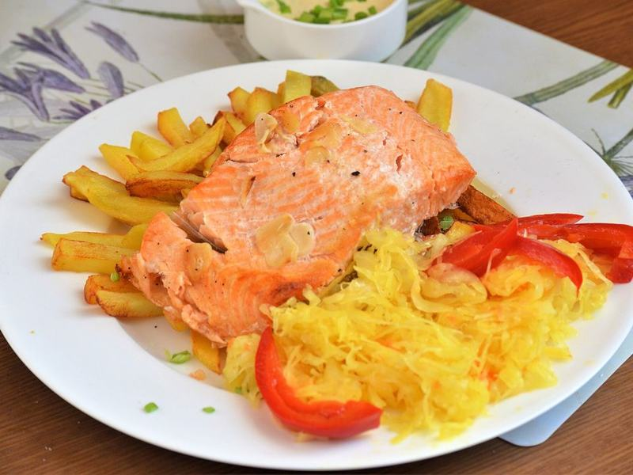

# Everything-Bagel Salmon & Crispy Smashed Potatoes

Photo: Silar · CC BY-SA 4.0 · [source](https://commons.wikimedia.org/wiki/File:02021_0611_(2)_Baked_salmon_and_chips.jpg)

**Dinner** · American comfort · 40 min · serves 4 · skill 2/3

> A seed-crusted salmon fillet roasted alongside shattering smashed potatoes and asparagus, with lemony yogurt sauce on the side.

| Per serving | kcal | Protein | Carbs | Fat | Fiber | Sodium | Cost |
| --- | --- | --- | --- | --- | --- | --- | --- |
| | 610 | 39 g | 38 g | 35 g | 6 g | 1090 mg | $4.35 |

Contains: fish, dairy, sesame

## Ingredients

- 1¼ lb salmon fillet, cut in 4 portions
- 2 tbsp everything bagel seasoning
- 1½ lb baby potatoes
- 1 lb asparagus, woody ends snapped off
- ¾ cup plain Greek yogurt
- 1 lemon
- 1 garlic clove, grated

From the pantry: 4 tbsp olive oil, salt, pepper

## Steps

1. Boil the potatoes in salted water until a knife slides in easily, 12 to 15 minutes. Drain and let them steam dry for a few minutes. Heat the oven to 450°F.
2. Oil a sheet pan, add the potatoes and smash each one flat with the bottom of a glass. Drizzle with 2 tbsp oil, season and roast 15 minutes.
3. Brush the salmon with oil and press the everything seasoning onto the tops. Toss the asparagus with oil and salt.
4. Flip the potatoes, add the salmon and asparagus to the pan and roast 10 to 12 minutes more, until the salmon flakes and the potatoes are deeply golden.
5. Stir the yogurt with the garlic, half the lemon's zest and juice, and salt. Serve everything with the sauce and lemon wedges.

**Tip:** Smash the potatoes thin. More craggy edges means more crunch.

## Storing

Fridge 3 days · freezer not recommended. Keep the yogurt sauce separate. Reheat salmon gently at 275°F for 10 minutes, or eat it cold on salads. Re-crisp potatoes in a hot oven or air fryer.

## Other ways to make it

- Cod
- Shrimp
- Chicken
