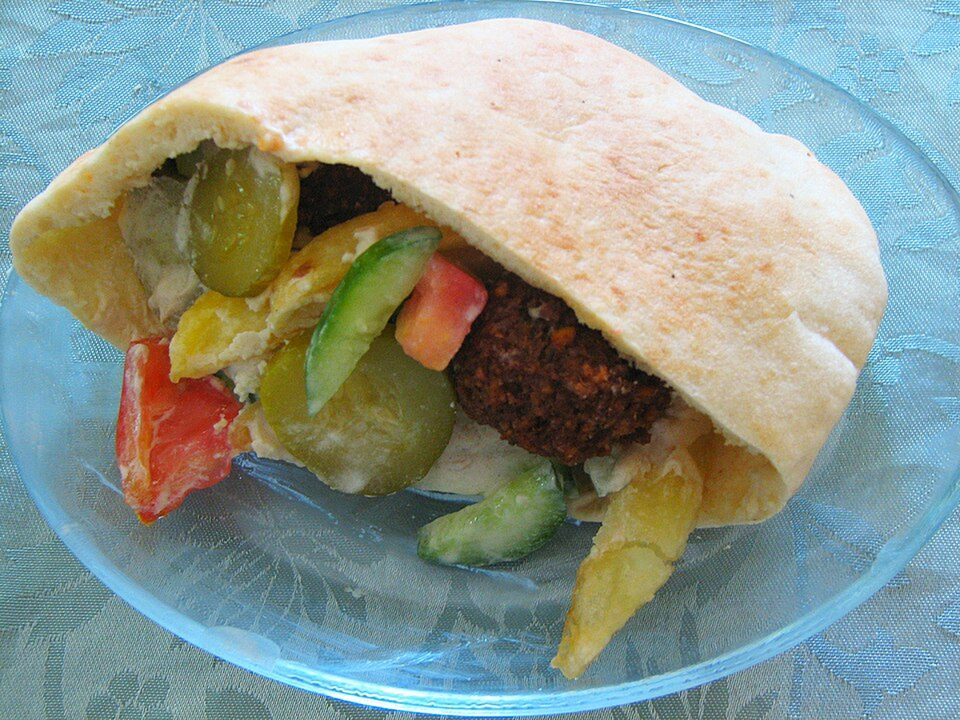

# Crispy Baked Falafel Pitas

Photo: Gilabrand at English Wikipedia · CC BY 3.0 · [source](https://commons.wikimedia.org/wiki/File:Pita_felafel.jpg)

**Dinner** · Lebanese & Levantine · 40 min · serves 4 · skill 2/3

> Herby, golden falafel (from canned chickpeas) stuffed into warm pitas with tahini sauce, tomatoes, cucumbers and pickled onions.

| Per serving | kcal | Protein | Carbs | Fat | Fiber | Sodium | Cost |
| --- | --- | --- | --- | --- | --- | --- | --- |
| | 680 | 22 g | 86 g | 30 g | 15 g | 1020 mg | $2.23 |

Contains: gluten, sesame

## Ingredients

- 2 cans chickpeas, drained and patted very dry
- 1 bunch parsley
- 1 bunch cilantro
- ½ onion
- 4 garlic cloves
- ½ cup tahini
- 2 lemons
- 4 pitas
- 2 tomatoes
- 1 cucumber

From the pantry: ⅓ cup flour, 2 tsp cumin, 1 tsp coriander, 1 tsp baking powder, ¼ cup olive oil, salt

## Steps

1. Heat the oven to 425°F with an oiled sheet pan inside.
2. Pulse the chickpeas, herbs, onion, garlic, cumin, coriander and 1 tsp salt in a food processor until finely chopped but not pasty. Stir in the flour and baking powder.
3. Shape into 16 small patties and lay on the hot pan. Brush with oil and bake 25 minutes, flipping halfway, until crisp.
4. Whisk the tahini with the juice of 1 lemon, a little garlic, salt and cold water until creamy and pourable.
5. Stuff warm pitas with falafel, tomatoes, cucumber and tahini sauce.

**Tip:** Dry chickpeas are key. Wet ones make mushy falafel.

## Storing

Fridge 4 days · freezer up to 3 months. Re-crisp falafel at 400°F for 8 minutes. Keep sauce separate.

