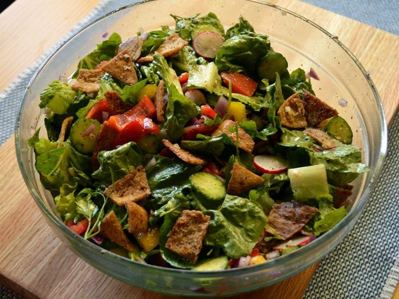

# Fattoush Salad with Sumac Chicken

Photo: Arousing Appetites · CC BY-SA 3.0 · [source](https://commons.wikimedia.org/wiki/File:Fattoush_mixed-salad.jpg)

**Lunch** · Lebanese & Levantine · 30 min · serves 4 · skill 1/3

> A crunchy Levantine bread salad of romaine, cucumber, tomato, herbs and golden toasted pita in a tart sumac-lemon dressing, topped with juicy sumac-rubbed chicken.

| Per serving | kcal | Protein | Carbs | Fat | Fiber | Sodium | Cost |
| --- | --- | --- | --- | --- | --- | --- | --- |
| | 540 | 46 g | 41 g | 22 g | 6 g | 640 mg | $3.32 |

Contains: gluten

## Ingredients

- 1½ lb boneless chicken breasts
- 3 pitas, torn into bite-size pieces
- 2 romaine hearts, chopped
- 1 English cucumber, chopped
- 1 lb Roma tomatoes, chopped
- ½ bunch parsley, chopped
- a handful of mint leaves
- 4 green onions, sliced
- 2 lemons, juiced
- 1 garlic clove, grated

From the pantry: 6 tbsp olive oil, 2 tbsp sumac, 1 tsp dried mint, 1 tsp honey, 1½ tsp salt, ½ tsp pepper

## Steps

1. Rub the chicken with 1 tbsp oil, 1 tbsp sumac, ½ tsp salt and the pepper. Cook in a skillet over medium-high heat until browned and 165°F inside, 5 to 6 minutes per side. Rest 5 minutes, then slice.
2. Toss the pita pieces with 2 tbsp oil and a pinch of salt and bake at 400°F, or toast in the skillet over medium heat, until golden and crisp, 6 to 8 minutes.
3. Whisk the remaining 3 tbsp oil with the lemon juice, garlic, dried mint, honey, the rest of the sumac and ½ tsp salt.
4. Toss the romaine, cucumber, tomatoes, green onions, parsley and mint with most of the dressing.
5. Fold in the pita just before serving, top with the chicken, drizzle with the last of the dressing, and dust with a little more sumac.

**Tip:** Sumac is a lemony red spice sold in the spice aisle or at Middle Eastern markets. A pinch of extra lemon zest stands in if you can't find it.

## Storing

Fridge 3 days · freezer not recommended. Store the greens, dressing, pita and chicken separately and toss at lunchtime. The chicken is good cold or microwaved for 1 minute.

## Other ways to make it

- Steak
- Shrimp
- Pork
- Tofu
