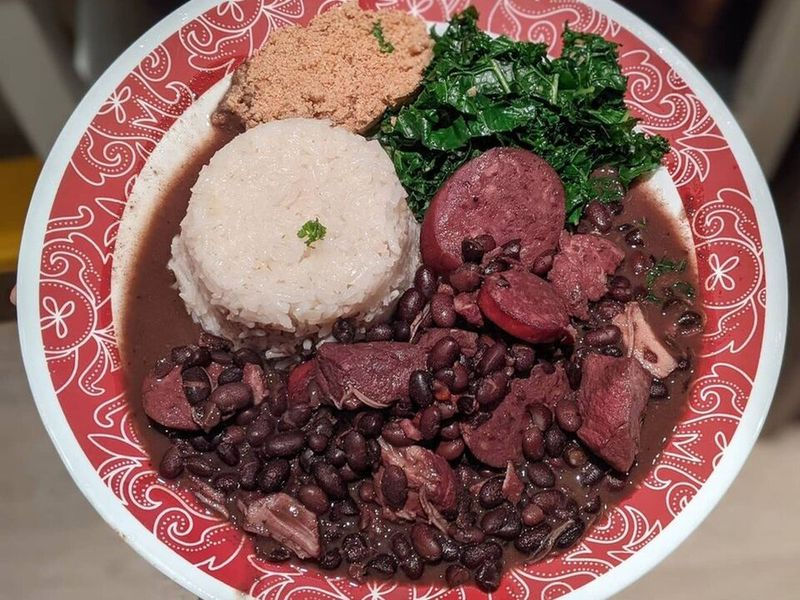

# Brazilian Feijoada (Black Bean & Pork Stew)

Photo: Bradleyzm · CC BY-SA 4.0 · [source](https://commons.wikimedia.org/wiki/File:Feijoada_%C3%A0_brasileira_-02.jpg)

**Dinner** · Brazilian · 120 min · serves 6 · skill 2/3

> Brazil's national dish, scaled for a home kitchen: black beans slow-simmered with pork shoulder, smoked sausage and bacon until thick and smoky, served with rice, garlicky greens, orange slices and farofa.

| Per serving | kcal | Protein | Carbs | Fat | Fiber | Sodium | Cost |
| --- | --- | --- | --- | --- | --- | --- | --- |
| | 875 | 43 g | 105 g | 32 g | 19 g | 1970 mg | $2.83 |

Contains: pork

## Ingredients

- 4 (15 oz) cans black beans, with their liquid
- 1 lb pork shoulder, in 1-inch cubes
- 9 oz smoked sausage, sliced
- 3 oz thick-cut bacon, chopped
- 1 large onion, chopped
- 6 garlic cloves, minced
- 4 cups chicken broth
- 1½ cups rice
- 10 oz kale or collards, thinly sliced
- 2 oranges, sliced
- ⅔ cup farofa (toasted cassava flour)

From the pantry: 1 tbsp oil, 2 tbsp tomato paste, 2 tbsp red wine vinegar, 1 tsp ground cumin, 2 bay leaves, salt, pepper

## Steps

1. Cook the bacon in a heavy pot over medium-high until browned, 5 minutes. Add the sausage and brown 4 minutes more, then lift both out.
2. Season the pork with salt and pepper and brown it in the fat left in the pot, in batches, about 6 minutes. Add the onion and two-thirds of the garlic and cook until soft, 5 minutes. Stir in the tomato paste and cumin for 1 minute.
3. Add the beans with their liquid, the broth, bay leaves, bacon and sausage. Simmer, partly covered, until the pork is tender and the beans are thick and creamy, about 1½ hours. Mash a cup of beans against the side to thicken, and stir in the vinegar and salt to taste.
4. In the last 20 minutes, cook the rice. Just before serving, sauté the greens with the rest of the garlic and a little oil over high heat until just wilted, 2 to 3 minutes.
5. Serve the feijoada over rice with the greens, orange slices and a spoonful of farofa on top.

**Tip:** Dried beans soaked overnight give the most authentic texture; use 1 lb and add an extra 2 cups of water. Farofa is sold in Latin and Brazilian aisles, or toast panko in butter as a stand-in.

Adapted from [Easy and Delish](https://www.easyanddelish.com/feijoada-black-bean-stew/).

## Storing

Fridge 5 days · freezer up to 3 months. Reheat gently with a splash of water; it tastes even better the next day.

