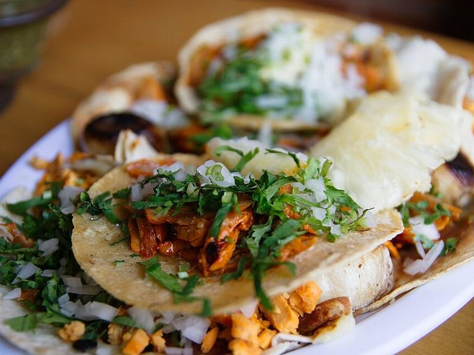

# Crispy Fish Tacos with Chipotle Slaw

Photo: William Neuheisel · CC BY 2.0 · [source](https://commons.wikimedia.org/wiki/File:01_Tacos_al_Pastor.jpg)

**Dinner** · Mexican · 30 min · serves 4 · skill 2/3

> Golden panko-crusted cod in warm tortillas with a crunchy lime-chipotle slaw, avocado and a squeeze of lime. Baja vibes on a weeknight.

| Per serving | kcal | Protein | Carbs | Fat | Fiber | Sodium | Cost |
| --- | --- | --- | --- | --- | --- | --- | --- |
| | 645 | 36 g | 53 g | 35 g | 12 g | 610 mg | $3.20 |

Contains: fish, dairy, gluten, egg

## Ingredients

- 1¼ lb cod or tilapia, in strips
- 1 cup panko
- 1 egg
- 12 corn tortillas
- 3 cups coleslaw mix
- ½ cup sour cream
- 1 tbsp adobo sauce
- 3 limes
- 2 avocados
- cilantro

From the pantry: ¼ cup flour, 1 tsp chili powder, oil for frying, salt

## Steps

1. Stir the sour cream with the adobo and juice of 1 lime. Toss half of it with the slaw and a pinch of salt.
2. Season the fish with salt and chili powder. Dredge in flour, then egg, then panko.
3. Fry in ¼ inch oil over medium-high until golden, 2 minutes per side. Drain.
4. Char the tortillas in a dry pan.
5. Fill with fish, slaw, avocado and cilantro. Drizzle with the remaining chipotle crema and serve with lime.

**Tip:** For an easier version, bake the breaded fish at 450°F on an oiled rack for 12 minutes.

## Storing

Fridge 1 days · freezer not recommended. Best eaten fresh. Re-crisp fish at 400°F for 6 minutes if needed.

## Other ways to make it

- Salmon
- Shrimp
- Chicken
