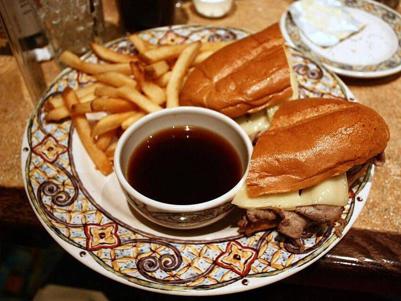

# French Dip Sandwiches with Onion Au Jus

Photo: Nick Ares · CC BY-SA 2.0 · [source](https://commons.wikimedia.org/wiki/File:French_dip.jpg)

**Lunch** · American comfort · 35 min · serves 4 · skill 1/3

> Thin-sliced roast beef warmed in a savory onion jus, piled into toasted rolls under melted provolone, with a cup of jus for dunking.

| Per serving | kcal | Protein | Carbs | Fat | Fiber | Sodium | Cost |
| --- | --- | --- | --- | --- | --- | --- | --- |
| | 605 | 44 g | 51 g | 24 g | 3 g | 2610 mg | $3.85 |

Contains: gluten, dairy, beef

## Ingredients

- 1¼ lb thinly sliced roast beef
- 4 hoagie or French rolls
- 8 slices provolone or Swiss
- 4 cups beef broth
- 1 onion, thinly sliced
- 2 garlic cloves, minced

From the pantry: 3 tbsp butter, 1 tbsp Worcestershire sauce, 1 tsp soy sauce, ½ tsp dried thyme, pepper

## Steps

1. Melt 2 tbsp butter in a saucepan over medium heat and cook the onion until soft and golden, 10 minutes. Stir in the garlic and thyme for 30 seconds.
2. Add the broth, Worcestershire and soy sauce. Simmer until slightly reduced and full-flavored, 10 minutes. Season with pepper.
3. Heat the oven to 400°F. Split the rolls, brush the cut sides with the remaining melted butter and toast on a sheet pan until golden, 4 to 5 minutes.
4. Turn the heat under the jus to low and dip the roast beef in it for 30 seconds, just to warm through. Pile it onto the bottom halves of the rolls with some of the onions.
5. Top with provolone, return to the oven until melted, 2 to 3 minutes, then close the sandwiches. Serve with small bowls of hot jus for dipping.

**Tip:** Don't boil the roast beef in the jus. A quick warm-up keeps it tender instead of tough and gray.

## Storing

Fridge 3 days · freezer not recommended. Keep the beef, rolls and jus separate. Reheat the jus until steaming and warm the beef in it briefly.

