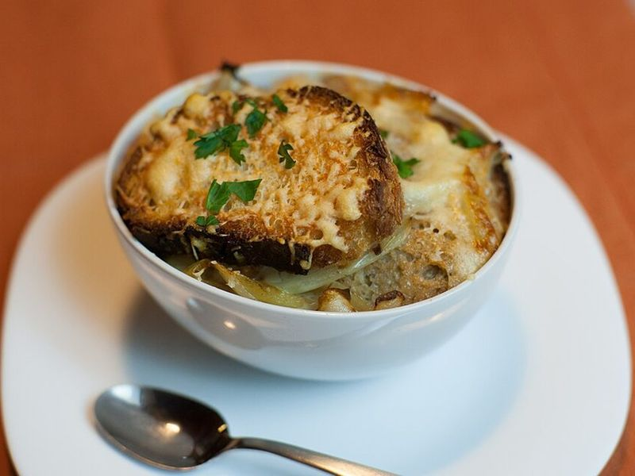

# French Onion Soup with Gruyère Croutons

Photo: Ludovic Péron · CC BY-SA 3.0 · [source](https://commons.wikimedia.org/wiki/File:Soupe_%C3%A0_l%27oignon.jpg)

**Lunch** · French · 110 min · serves 4 · skill 2/3

> Onions cooked low and slow in butter until deep amber and jammy, simmered in rich beef broth and crowned with toasted baguette under bubbling Gruyère.

| Per serving | kcal | Protein | Carbs | Fat | Fiber | Sodium | Cost |
| --- | --- | --- | --- | --- | --- | --- | --- |
| | 585 | 22 g | 48 g | 35 g | 6 g | 2050 mg | $2.96 |

Contains: gluten, dairy, beef

## Ingredients

- 2½ lb yellow onions, halved and thinly sliced
- 7 tbsp butter
- 6 cups beef broth
- 8 slices baguette
- 6 oz Gruyère, shredded

From the pantry: 2 tbsp flour, ¾ cup dry white wine (optional), 2 bay leaves, ½ tsp dried thyme, salt, pepper

## Steps

1. Melt the butter in a heavy pot over medium heat, add the onions and stir to coat. Turn the heat to medium-low and cook 30 minutes, stirring every few minutes, until soft and translucent.
2. Turn the heat to medium, add 1 tsp salt and cook another 20 to 30 minutes, stirring more often and scraping up the brown bits, until the onions are a deep golden brown.
3. Add the wine and boil 2 minutes until mostly gone, then sprinkle in the flour and stir 1 minute.
4. Add the broth, thyme and bay leaves, cover and simmer gently 30 minutes. Season to taste with salt and pepper.
5. Toast the baguette slices under the broiler until golden on both sides, pile with Gruyère and broil until bubbling and spotted brown. Ladle soup into bowls and float 2 cheese toasts on each.

**Tip:** Do not rush the onions with high heat; they burn before they sweeten. For the classic look, ladle into oven-safe crocks, top with toast and cheese and broil the whole bowl.

Adapted from [RecipeTin Eats](https://www.recipetineats.com/french-onion-soup/).

## Storing

Fridge 5 days · freezer up to 3 months. Store soup without the toasts. Reheat on the stove and make fresh cheese toasts.

