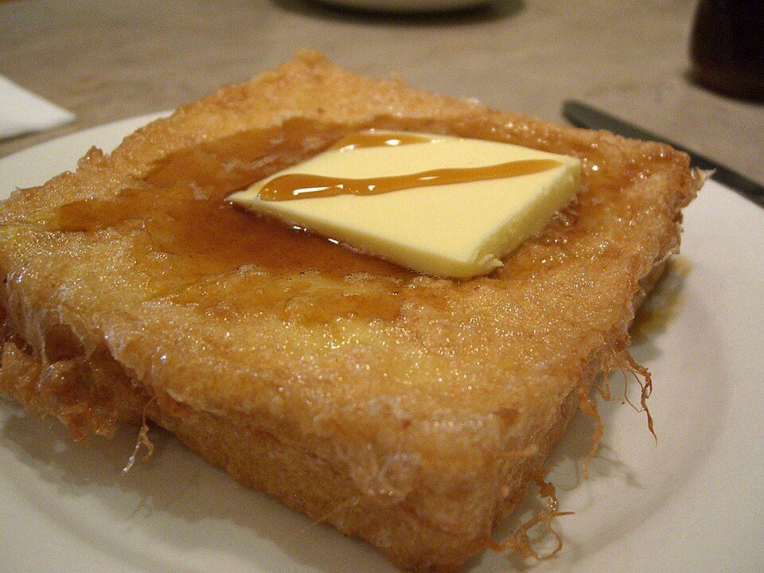

# Brioche French Toast

Photo: avlxyz from (optional) · CC BY-SA 2.0 · [source](https://commons.wikimedia.org/wiki/File:HKStyleFrenchtoast.jpg)

**Breakfast** · American comfort · 20 min · serves 4 · skill 1/3

> Thick brioche soaked in a vanilla-cinnamon custard and griddled until crisp outside and custardy inside. Weekend brunch royalty.

| Per serving | kcal | Protein | Carbs | Fat | Fiber | Sodium | Cost |
| --- | --- | --- | --- | --- | --- | --- | --- |
| | 765 | 22 g | 100 g | 31 g | 4 g | 970 mg | $2.08 |

Contains: dairy, gluten, egg

## Ingredients

- 1 brioche loaf, in 8 thick slices
- 4 eggs
- 1 cup milk or half-and-half
- butter, for the pan
- maple syrup
- berries

From the pantry: 2 tbsp sugar, 1 tsp cinnamon, 1 tsp vanilla, pinch of salt, powdered sugar

## Steps

1. Whisk the eggs, milk, sugar, cinnamon, vanilla and salt in a shallow dish.
2. Leave the bread out for an hour (or toast lightly) so it's a little dry. It soaks up more custard.
3. Dip each slice for about 10 seconds per side.
4. Cook in butter over medium heat until deep golden, 3 minutes per side.
5. Serve with maple syrup, berries and a dusting of powdered sugar.

**Tip:** Keep finished slices in a 200°F oven on a rack while you cook the rest.

## Storing

Fridge 3 days · freezer up to 2 months. Freeze between parchment. Reheat in a toaster or 375°F oven.

