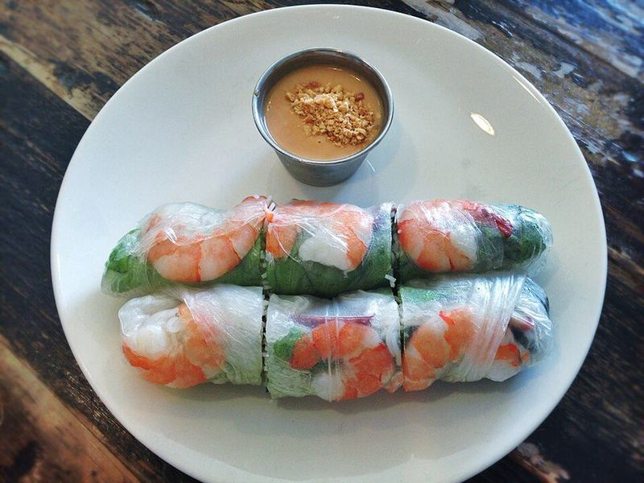

# Shrimp Summer Rolls with Peanut Dipping Sauce

Photo: T.Tseng · CC BY 2.0 · [source](https://commons.wikimedia.org/wiki/File:Spring_rolls_with_peanut_sauce.jpg)

**Lunch** · Vietnamese · 40 min · serves 4 · skill 2/3

> Translucent rice paper rolls packed with pink shrimp, noodles, mint and crisp vegetables, dunked in a creamy hoisin-peanut sauce. Cool, fresh and filling.

| Per serving | kcal | Protein | Carbs | Fat | Fiber | Sodium | Cost |
| --- | --- | --- | --- | --- | --- | --- | --- |
| | 495 | 32 g | 67 g | 12 g | 4 g | 1100 mg | $4.08 |

Contains: shellfish, nuts, gluten

## Ingredients

- 1 lb raw shrimp, peeled
- 12 rice paper rounds
- 4 oz rice vermicelli
- 1 head butter lettuce, leaves torn
- 1 package fresh mint, leaves picked
- ½ bunch cilantro
- ½ cucumber, cut in thin matchsticks
- 2 carrots, cut in thin matchsticks
- ⅓ cup peanut butter
- 2 tbsp hoisin sauce
- 2 tsp soy sauce
- 1 lime, juiced

From the pantry: 1 tsp sugar, 1 tsp rice vinegar, ½ tsp chili flakes, salt

## Steps

1. Cook the vermicelli in boiling water until tender, 3 to 4 minutes. Lift out, rinse under cold water and drain well. Drop the shrimp into the same pot and simmer until pink and curled, 2 minutes, then chill in cold water and halve each one lengthwise.
2. Whisk the peanut butter, hoisin, soy, lime juice, sugar, vinegar and chili flakes with 3 to 4 tbsp warm water until smooth and pourable.
3. Fill a wide shallow dish with warm water. Dip one rice paper round for 10 to 15 seconds until just pliable, then lay it on a damp towel.
4. Place 3 shrimp halves cut side up across the lower third, then a lettuce leaf, a small bundle of noodles, cucumber, carrot, mint and cilantro.
5. Fold the bottom over the filling, fold in the sides and roll up snugly. Repeat with the rest, and serve with the peanut sauce.

**Tip:** Pull the rice paper out while it still feels a little stiff. It keeps softening on the towel, and an oversoaked wrapper tears.

## Storing

Fridge 1 days · freezer not recommended. Wrap each roll in plastic wrap so they don't stick together. Eat cold within a day; the sauce keeps 5 days.

## Other ways to make it

- Chicken
- Steak
- Pork
- Tofu
