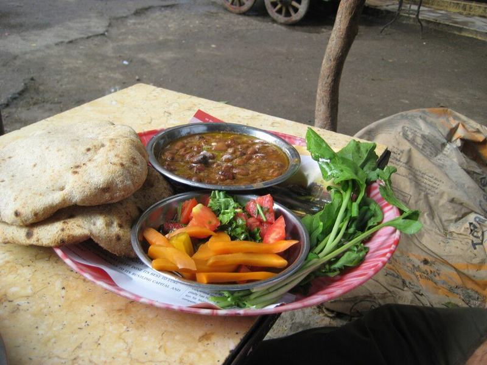

# Ful Medames with Jammy Eggs & Warm Pita

Photo: Zachbe at en.wikipedia · CC BY-SA 3.0 · [source](https://commons.wikimedia.org/wiki/File:Ful_medames.jpg)

**Breakfast** · Egyptian · 25 min · serves 4 · skill 1/3

> Egypt's everyday breakfast: creamy fava beans mashed with garlic, cumin, lemon and plenty of olive oil, topped with tomato, cucumber and parsley and eaten with eggs and pita.

| Per serving | kcal | Protein | Carbs | Fat | Fiber | Sodium | Cost |
| --- | --- | --- | --- | --- | --- | --- | --- |
| | 585 | 27 g | 75 g | 20 g | 13 g | 1250 mg | $1.97 |

Contains: egg, gluten

## Ingredients

- 2 cans (16 oz) fava beans (ful medames), with their liquid
- 3 garlic cloves, grated
- 1 lemon, juiced
- 2 Roma tomatoes, diced
- ½ English cucumber, diced
- ½ bunch parsley, chopped
- 4 eggs
- 4 pitas, warmed

From the pantry: ¼ cup olive oil, 1½ tsp cumin, ½ tsp red pepper flakes, salt

## Steps

1. Lower the eggs into boiling water and cook 8 minutes for firm-but-tender yolks, then move to ice water. Peel and halve.
2. Tip the beans and their liquid into a saucepan with ½ cup water and simmer over medium, stirring, until hot and the liquid has thickened slightly, 6 to 8 minutes.
3. Off the heat, add the garlic, cumin, lemon juice, 2 tbsp olive oil and ½ tsp salt. Mash roughly with a potato masher or fork, leaving some beans whole. Taste and add more lemon or salt.
4. Spoon into shallow bowls, pile the tomato, cucumber and parsley on top, drizzle with the remaining olive oil and sprinkle with red pepper flakes.
5. Serve with the eggs and warm pita for scooping.

**Tip:** Be generous with the olive oil and lemon at the end. Plain fava beans taste flat; those two make them taste like the street-cart version.

## Storing

Fridge 4 days · freezer up to 3 months. Store the beans separately from the vegetables. Reheat with a splash of water, then add fresh lemon and oil.

