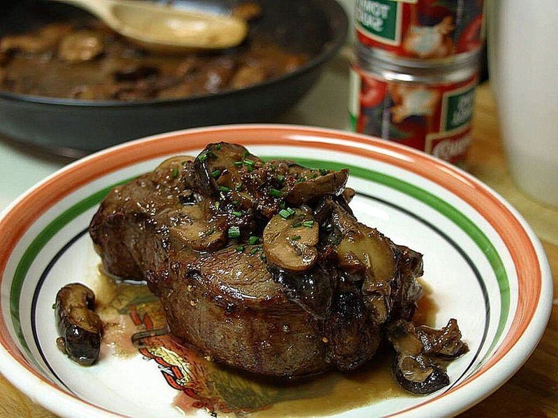

# Garlic Butter Steak Bites & Potatoes

Photo: Jon Sullivan · Public domain · [source](https://commons.wikimedia.org/wiki/File:Steak_with_shitaki_mushrooms.jpg)

**Dinner** · American comfort · 30 min · serves 4 · skill 1/3

> Seared sirloin bites tossed in sizzling garlic-herb butter with crispy potatoes and charred asparagus. Steakhouse flavor in one pan.

| Per serving | kcal | Protein | Carbs | Fat | Fiber | Sodium | Cost |
| --- | --- | --- | --- | --- | --- | --- | --- |
| | 575 | 45 g | 36 g | 29 g | 6 g | 480 mg | $4.88 |

Contains: beef, dairy

## Ingredients

- 1½ lb sirloin, in 1-inch cubes
- 1½ lb baby potatoes, quartered
- 1 lb asparagus
- 4 tbsp butter
- 6 garlic cloves, minced
- parsley

From the pantry: 2 tbsp oil, red pepper flakes, flaky salt, pepper

## Steps

1. Microwave the potatoes, covered, with a splash of water for 5 minutes. Then fry in 1 tbsp oil in a large skillet until golden and crisp, 8 minutes. Remove.
2. Char the asparagus in the same pan with a pinch of salt, 3 minutes. Remove.
3. Pat the steak very dry and season well. Sear in the remaining oil over high heat in one layer, 1 to 2 minutes per side.
4. Lower the heat, add the butter, garlic and pepper flakes and toss for 1 minute as the butter foams.
5. Return the potatoes and asparagus, toss and finish with parsley and flaky salt.

**Tip:** Don't crowd the pan. Sear the steak in two batches if needed, or it will steam instead of brown.

## Storing

Fridge 3 days · freezer not recommended. Reheat briefly in a hot skillet so the steak doesn't overcook.

## Other ways to make it

- Chicken
- Shrimp
- Pork
- Tofu
